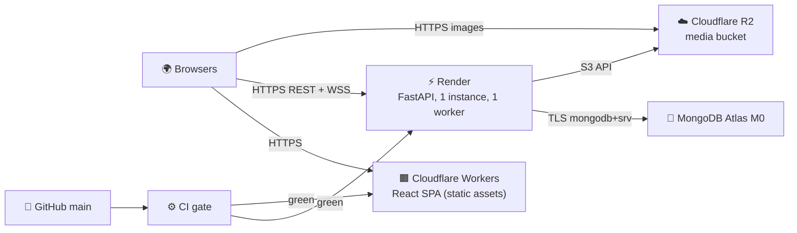

# MatchGrid Production Deployment Guide

MatchGrid runs as a **zero-cost, split-cloud stack**: a static React app on a CDN, a single FastAPI container for REST and the live WebSocket, a managed MongoDB, and an object store for images.



| Tier | Host | What it does |
|---|---|---|
| Frontend SPA | **Cloudflare Workers** (static assets, `matchgrid.<account>.workers.dev`) | Serves the Vite build from `apps/frontend/dist` with an SPA fallback (`apps/frontend/wrangler.jsonc`) and security/cache headers (`apps/frontend/public/_headers`). Talks to the API **directly** (cross-origin). |
| API + live socket | **Render** (Docker web service) | `apps/backend/Dockerfile` → `docker-entrypoint.sh` → `uvicorn` on `$PORT`. Runs migrations at start. |
| Database | **MongoDB Atlas M0** | Persistent data, UTC (`tz_aware`), indexes created by the migrations. |
| Media | **Cloudflare R2** | Crests, headshots, banners. Uploads go browser → API → R2 (the browser never holds R2 credentials). |

> **Same-origin alternative.** `docker compose`-style hosting puts the bundled nginx (`apps/frontend/Dockerfile`) in front of both: it serves the SPA and proxies `/api` and `/ws` to the backend, so the browser sees one origin and `VITE_API_URL` stays empty. See [§7](#7-self-hosting-with-docker-no-cloudflarerender).

---

## 1. Environment variables

### 1.1 Backend (Render → *Environment*)

| Variable | Production value | Notes |
|---|---|---|
| `ENVIRONMENT` | `production` | Turns on the fail-fast checks in §2, disables `/docs`, `/redoc`, `/openapi.json`, adds HSTS, enforces the WebSocket origin check. |
| `DEBUG` | `false` | |
| `MONGO_URI` | `mongodb+srv://matchgrid_api:<password>@<cluster>.mongodb.net/?retryWrites=true&w=majority` | **Secret.** |
| `MONGO_DB_NAME` | `matchgrid` | |
| `JWT_SECRET` | `python3 -c "import secrets; print(secrets.token_hex(32))"` | **Secret.** ≥ 32 characters. Changing it signs everyone out. |
| `ADMIN_BOOTSTRAP_USERNAME` | `superadmin` (your choice) | Used once, on the first boot of an empty database. |
| `ADMIN_BOOTSTRAP_PASSWORD` | ≥ 12 random characters | **Secret.** Not a placeholder, not the username. |
| `CORS_ORIGINS` | `https://matchgrid.<account>.workers.dev` | Comma-separated exact origins. Also gates the WebSocket handshake. `https` only, no wildcard, no path, no localhost. |
| `TRUSTED_PROXY_HOPS` | `1` (verify, §4.4) | How many proxies append to `X-Forwarded-For` in front of the app. Must be ≥ 1. |
| `CLIENT_IP_HEADER` | `cf-connecting-ip` | Render fronts every request with Cloudflare, whose proxy addresses in `X-Forwarded-For` change between requests. This header (always overwritten by Cloudflare) gives the login throttle one stable address per client. Leave empty where clients can reach the API around such a proxy. |
| `AUTO_MIGRATE` | `true` | Runs the migrations at start, under a database lock. |
| `R2_ACCOUNT_ID`, `R2_ACCESS_KEY_ID`, `R2_SECRET_ACCESS_KEY`, `R2_BUCKET_NAME`, `R2_PUBLIC_BASE_URL` | from Cloudflare | **Secrets** (except the bucket name). `R2_PUBLIC_BASE_URL` must be `https://`. All five are required. |
| `PORT` | *set by Render (10000)* | Do not set it yourself. |

### 1.2 Frontend (Cloudflare → Workers & Pages → `matchgrid` → Settings → Builds → *Build variables*)

| Variable | Value | Notes |
|---|---|---|
| `VITE_API_URL` | `https://<service>.onrender.com` | No trailing slash. Empty = same origin (local dev, Docker). |
| `VITE_WS_URL` | `wss://<service>.onrender.com` | Optional: derived from `VITE_API_URL` when empty (`https` → `wss`). |

These are **baked into the bundle**: changing them needs a redeploy (rebuild) of the frontend.

---

## 2. What production refuses to start with

With `ENVIRONMENT=production` the API aborts at boot and lists **every** problem it finds (`app/core/production_safety.py`):

| Setting | Rejected |
|---|---|
| `JWT_SECRET` | any known placeholder, or shorter than 32 characters |
| `CORS_ORIGINS` | empty; `*` or any wildcard; `http://`; `localhost`, `127.x`, `0.0.0.0`, `::1`, `.local`, private addresses; entries with a path |
| `MONGO_URI` | not `mongodb://` / `mongodb+srv://`; localhost or private host (any member of a replica set); the template password; Atlas without credentials |
| `DEBUG` | `true` |
| `TRUSTED_PROXY_HOPS` | less than 1 |
| `R2_*` | any of the five missing; `R2_PUBLIC_BASE_URL` not `https://` |
| `ADMIN_BOOTSTRAP_PASSWORD` *(checked when the admin is created)* | known placeholder or common password, shorter than 12 characters, or equal to the username |

The same checks are covered by `apps/backend/tests/test_production_safety.py`, and CI proves the built image refuses an insecure production boot.

---

## 3. Provision the services

### Step 1 — MongoDB Atlas (M0)
1. Create a free **M0** cluster, in the region closest to your Render region.
2. **Database Access** → add user `matchgrid_api`, a long random password, role **Read and write to any database** restricted to database `matchgrid` (custom role `readWrite` on `matchgrid` is enough; it can create the indexes the migrations need).
3. **Network Access** → `0.0.0.0/0`. Render's free tier has no fixed outbound IP, so the password is your protection: make it long and keep it only in Render's secret store.
4. **Connect → Drivers** → copy the `mongodb+srv://` string into `MONGO_URI` (add the database user's password).
5. **Backups:** M0 has **no cloud backup**. Schedule a periodic `mongodump` (or use a paid tier) before real data matters.

### Step 2 — Cloudflare R2
1. Create bucket `matchgrid-media`.
2. **Public access:** enable the `r2.dev` URL for a first launch, or (better) connect a custom domain. Copy it to `R2_PUBLIC_BASE_URL` (no trailing slash).
3. **R2 → Manage API tokens** → new token, permission **Object Read & Write**, scoped to this one bucket. Copy the Access Key ID and Secret into `R2_ACCESS_KEY_ID` / `R2_SECRET_ACCESS_KEY`; the Account ID is on the R2 overview page.
4. **Bucket CORS** (browsers only *read* images, uploads go through the API):
   ```json
   [{ "AllowedOrigins": ["https://matchgrid.<account>.workers.dev"], "AllowedMethods": ["GET", "HEAD"], "AllowedHeaders": ["*"], "MaxAgeSeconds": 3600 }]
   ```
5. **Use a different bucket and token for CI** (§6). If an R2 key was ever committed to git, treat it as leaked and **rotate it now** (this repository's history contains one).
6. Images are allowed from any `https:` origin by the CSP in `apps/frontend/public/_headers` (organizers may also paste external image URLs), so a custom media domain needs no frontend change.

### Step 3 — Render (API)
1. **New → Web Service** → connect the GitHub repository, **Language: Docker**.
2. Settings:
   - **Root Directory:** *(empty, the repository root)*
   - **Dockerfile Path:** `./apps/backend/Dockerfile`
   - **Docker Build Context Directory:** `.`
   - **Health Check Path:** `/health`
   - **Auto-Deploy:** *After CI Checks Pass*
   - **Instances:** exactly **1** (see §8). Leave the start command empty: the image's entrypoint runs `uvicorn` on `$PORT`.
3. Add the variables from §1.1. First deploy with `CORS_ORIGINS` set to the Workers URL you expect (you can correct it in Step 5).
4. After it is live: `curl https://<service>.onrender.com/health` → `{"status":"ok"}`.
5. **Free tier caveat:** the service sleeps after ~15 minutes without traffic and takes about a minute to wake, which also drops open live sockets (the app reconnects). Ping `/health` every 10 minutes (UptimeRobot or a GitHub Actions cron) if that matters for match days.

### Step 4 — Cloudflare Workers (frontend)
1. **Workers & Pages → Create → Import a repository**, pick this repository, name the Worker `matchgrid`.
2. **Settings → Builds:**
   - **Root directory:** `apps/frontend`
   - **Build command:** `cd ../.. && bun install --frozen-lockfile && cd apps/frontend && bun run build`
   - **Deploy command:** `npx wrangler deploy` (reads `apps/frontend/wrangler.jsonc`: static assets from `dist/` with `not_found_handling: "single-page-application"`, so deep links and reloads such as `/login` or `/t/<slug>/bracket` serve the app instead of a 404)
   - **Build variables:** `VITE_API_URL` and `VITE_WS_URL` from §1.2. They are baked into the bundle: **without them every API call goes to the Worker itself and 404s.** Changing them needs a rebuild.
3. `apps/frontend/public/_headers` (copied into `dist/`) sets HSTS, the Content-Security-Policy, `X-Frame-Options: DENY`, `nosniff`, Referrer/Permissions-Policy and a one-year immutable cache for the content-hashed `/assets/*`. **If the API moves to another host, update `connect-src` there.**
4. Deploy, then open the site: the hub should list tournaments and the connection dot in the header should turn green. A reload on `/login` must show the sign-in page.
5. Bun must read `bun.lock` (Bun ≥ 1.2). If the build image's Bun is older, add a build variable `BUN_VERSION=1.4.2`.

### Step 5 — Wire them together
1. Copy the final Workers URL into Render's `CORS_ORIGINS` (exact, `https://…`, no trailing path) and redeploy the API.
2. Set the Workers build variables to the Render URL if you have not yet, and redeploy the frontend.
3. Optionally put a custom domain on the Worker; then update `CORS_ORIGINS` and the R2 bucket CORS to match.

---

## 4. Verify the launch

### 4.1 Automated smoke test
From a machine with `curl` and `bun`:

```bash
SMOKE_ADMIN_USER=superadmin SMOKE_ADMIN_PASSWORD='<bootstrap password>' \
  scripts/smoke.sh https://<service>.onrender.com https://matchgrid.<account>.workers.dev --full
```

It checks: `/health` and `/health/db` (and that no collection counts leak); `/docs` and `/openapi.json` disabled; HSTS and nosniff headers; the SPA root, a deep link and the CSP header; CORS allowed for the frontend origin and refused for a stranger; superadmin sign-in; the WebSocket answers ping, accepts your origin and refuses a foreign one; and with `--full` a goal logged on a temporary match arrives on a spectator socket and an image uploads to R2 and loads back (everything it creates is deleted). The last step deliberately provokes the login throttle, so your IP is locked out of login for up to a minute afterwards (`--skip-ratelimit` omits it).

### 4.2 By hand (2 minutes)
1. Sign in at `/login` as the bootstrap superadmin → lands on `/superadmin`.
2. Create an organizer, sign in as them, create a competition with two clubs and a crest image (proves R2).
3. Open the public page in a second window, start a match as a scorer, log a goal: the public score updates within a second.

### 4.3 First-boot note
The migrations create a default **"MatchGrid"** tournament (with its three knockout placeholder matches) owned by the superadmin. No other data is ever inserted at startup (demo data is a manual, local-only `bun run seed:demo`). Delete it from *Superadmin → Global Tournament Oversight* if you do not want it on the public hub.

### 4.4 Check the login throttle's client address
On Render set `CLIENT_IP_HEADER=cf-connecting-ip` (§1.1): the smoke test's last step must then report HTTP 429 after a few bad logins. Without it, the throttle keys on an `X-Forwarded-For` entry, and a wrong hop count fails silently, so test it once:
- **Too low** (everyone shares one throttle, usually the CDN's address): trigger 6 bad logins from your laptop, then try one bad login from your phone on mobile data. If the phone is throttled immediately, raise `TRUSTED_PROXY_HOPS` to `2` (a CDN in front of Render).
- **Too high** (a client can dodge the throttle): send 8 bad logins, each with a different made-up header, e.g. `curl -H "X-Forwarded-For: 10.0.0.$i" …`. You must still get HTTP 429; if you do not, lower the value.

---

## 5. Launch checklist (print this)

**Accounts and secrets**
- [ ] Atlas M0 cluster, database user `matchgrid_api` (`readWrite` on `matchgrid`), network `0.0.0.0/0`
- [ ] R2 bucket, bucket-scoped Object Read & Write token, public URL, bucket CORS set
- [ ] **Old R2 key rotated** (it is in git history); CI uses its own bucket
- [ ] `JWT_SECRET` generated with `secrets.token_hex(32)`
- [ ] `ADMIN_BOOTSTRAP_PASSWORD` ≥ 12 random characters, stored in a password manager

**Render**
- [ ] Docker, Dockerfile `./apps/backend/Dockerfile`, context `.`, health check `/health`
- [ ] Exactly one instance
- [ ] `ENVIRONMENT=production`, `DEBUG=false`, `AUTO_MIGRATE=true`, `CLIENT_IP_HEADER=cf-connecting-ip`
- [ ] `CORS_ORIGINS` = the Workers origin, `https`, no wildcard
- [ ] `TRUSTED_PROXY_HOPS` verified (§4.4)
- [ ] Auto-Deploy *After CI Checks Pass*
- [ ] Optional: 10-minute `/health` ping against cold starts

**Cloudflare Workers**
- [ ] Root `apps/frontend`, build and deploy commands from Step 4, `wrangler.jsonc` picked up
- [ ] Build variables `VITE_API_URL` / `VITE_WS_URL` set, rebuilt after the last change
- [ ] A reload on `/login` serves the app; `curl -I` on `/` shows the CSP header

**GitHub**
- [ ] Branch protection on `main`: require *Full-Stack Regression* and *Docker images build*
- [ ] Repository secrets `R2_*` (CI bucket) if you want the R2 media spec to run in CI

**After deploy**
- [ ] `scripts/smoke.sh … --full` passes
- [ ] Hub loads, connection dot green, a live goal reaches a second window
- [ ] Default "MatchGrid" tournament kept or removed, on purpose
- [ ] A `mongodump` schedule exists

---

## 6. CI/CD

`.github/workflows/ci.yml` runs on every push to `main`, `feat/**`, `fix/**`, `refactor/**` and every pull request to `main`:

| Job | What it does |
|---|---|
| **Full-Stack Regression** | Node 24 action runtimes (checkout v7, cache v6, setup-python v7, upload-artifact v7), Python 3.14, Bun pinned to the lockfile's version, MongoDB 7 service container, `bun install --frozen-lockfile`, Playwright Chromium, then `bun run test:all`: Pytest, Vitest, production build and the Playwright suite, then checks the build carries `_headers` and `wrangler.jsonc` keeps the SPA fallback. 25-minute timeout, pip and Bun caches, Playwright report uploaded on failure. |
| **Docker images build** | Builds the API and web images from the repository root, checks the API image **refuses to boot** with `ENVIRONMENT=production` and development settings, and that nginx accepts the rendered config. |

R2 credentials are only configured for runs that have the repository secrets and are not fork pull requests. The R2 media spec uploads to and purges from a real bucket, so CI **skips it when no credentials are present**; everything else runs without them. Use a dedicated CI bucket and token for the secrets.

To make the gate binding, protect `main` (require both jobs) so only green code merges, and set Render to *Auto-Deploy → After CI Checks Pass*. Cloudflare Workers Builds then deploys the green `main`.

---

## 7. Self-hosting with Docker (no Cloudflare/Render)

Both images build from the repository root:

```bash
docker build -f apps/backend/Dockerfile  -t matchgrid-api .
docker build -f apps/frontend/Dockerfile -t matchgrid-web .
docker run -d --name api -p 8000:8000 --env-file apps/backend/.env matchgrid-api
docker run -d --name web -p 80:80 -e API_UPSTREAM=http://api:8000 --link api matchgrid-web
```

The web image proxies `/api`, `/ws` and `/health` to `API_UPSTREAM` (default `http://backend:8000`), so no CORS or `VITE_*` variables are needed. nginx adds one `X-Forwarded-For` entry, matching `TRUSTED_PROXY_HOPS=1`; put TLS in front (Caddy, Traefik, a cloud load balancer) and raise the hop count by one per extra proxy.

---

## 8. Scaling constraints and known limits

Run **one API instance with one worker** until these move to shared state (Redis or similar):

| Concern | Today | If you run a second worker/instance |
|---|---|---|
| Live WebSocket rooms (`app/core/websocket.py`) | In-process room registry | A goal logged on instance A never reaches spectators connected to B. |
| Login throttling (`app/core/rate_limit.py`) | In-process, per client IP | The limit is multiplied by the number of instances. |
| Startup migrations | Guarded by a Mongo lock | Safe with several instances. |

Other deliberate limits:
* **Sessions** are 12-hour JWTs in browser `localStorage`, with no server-side revocation. Deactivating a user takes effect at once (the account is re-read on every request), but a token for a still-active account is valid until it expires.
* **WebSocket origin** is checked in production against `CORS_ORIGINS`. Clients that send no `Origin` header (scripts, probes) are allowed: they are not browsers, so another website cannot drive them.
* **Uploads** are capped at 5 MB (enforced while streaming), must be JPEG/PNG/WebP and are structurally verified. EXIF metadata is not stripped.
* **Free-tier cold starts** drop live sockets; the client reconnects on its own.
* **Draft tournaments are private.** A `draft` is left out of the public directory and every public read (pages, lists, live strip) answers 404 for it, except to the superadmin, its organizer and the scorers assigned in it. Publish it by setting the status to `active`.
* **Deployment identifiers** such as the `dcl_scoreboard` test database name and older GitHub names predate the MatchGrid rename. They are left alone on purpose: renaming the production database value would point the app at an empty database.

---

## 9. Troubleshooting

| Symptom | Likely cause |
|---|---|
| API exits at boot with `Refusing to start with ENVIRONMENT=production…` | Read the list: it names every setting to fix (§2). |
| Site loads but every call fails with a CORS error | `CORS_ORIGINS` is not the exact Workers origin (scheme, host, no trailing path), or the API was not redeployed after changing it. |
| The hub shows "An error occurred"; calls go to `…workers.dev/api/…` and return 404 | `VITE_API_URL` was empty at build time. Set the Workers build variables and rebuild the frontend. |
| Reloading `/login` or any `/t/...` page gives a 404 | The Worker was deployed without `apps/frontend/wrangler.jsonc` (SPA fallback): check the root directory and deploy command (Step 4). |
| Bad logins are never throttled (no 429) | `CLIENT_IP_HEADER` is not set on Render, so each request reaches the throttle from a different proxy address (§4.4). |
| Live scores never update; connection dot is red | `VITE_WS_URL` wrong, or `CORS_ORIGINS` rejects the origin (the socket is refused with code 1008), or the free instance is asleep. |
| Crests and photos are blocked | `R2_PUBLIC_BASE_URL` is `http://`, or the bucket's public (`r2.dev`) access is off: the object URL then answers 401. |
| Uploads return 503 | One of the `R2_*` variables is empty. |
| One bad password locks several people out | `TRUSTED_PROXY_HOPS` is too low (§4.4). |
| Render deploys but `/health` times out | Wrong health check path, or the process cannot reach Atlas (check the Atlas network allowlist and the URI password). |
