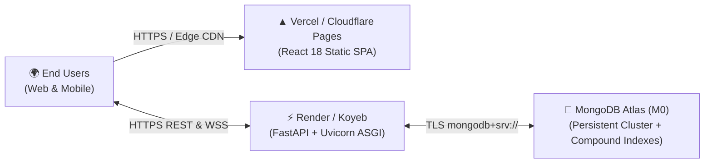

# MatchGrid Production Deployment Guide

MatchGrid is engineered for a **zero-cost, split-cloud production topology** combining high availability, sub-millisecond edge CDN delivery for the React SPA, and low-latency WebSocket connection handling for live telemetry:



---

## 1. Cloud Infrastructure Overview

| Tier | Recommended Host | Free-Tier Specs | Target Responsibilities |
|---|---|---|---|
| **Frontend SPA** | [Vercel](https://vercel.com) / [Cloudflare Pages](https://pages.cloudflare.com) | Unlimited Bandwidth, Global Edge CDN | Hosts compiled Vite SPA bundle (`apps/frontend/dist`), client-side routing fallback (`/* -> /index.html`). |
| **Backend & WS** | [Render](https://render.com) / [Koyeb](https://koyeb.com) | 512 MB RAM, 0.1 vCPU, Native WSS | Runs FastAPI ASGI server (`uvicorn app.main:app`), room-scoped WebSocket hub (`/ws/live`), automated startup migrations. |
| **Database** | [MongoDB Atlas (M0)](https://www.mongodb.com/atlas) | 512 MB Storage, Shared RAM, Automated Backups | Persistent database cluster with `tz_aware=True` UTC storage and compound indexes. |

---

## 2. Environment Variables Specification

### Backend Environment Variables (`apps/backend`)

| Variable | Recommended Production Value | Description |
|---|---|---|
| `ENVIRONMENT` | `production` | Enables fail-fast production security assertions (`production_safety.py`). |
| `DEBUG` | `false` | Disables debug logs and development traceback exposure. |
| `MONGO_URI` | `mongodb+srv://<user>:<password>@cluster0.xxx.mongodb.net/?retryWrites=true&w=majority` | Secure TLS connection string to MongoDB Atlas. |
| `MONGO_DB_NAME` | `matchgrid` | Production database name. |
| `JWT_SECRET` | 64-char hex string (`python3 -c "import secrets; print(secrets.token_hex(32))"`) | Secret HMAC-SHA256 key for signing JWT auth tokens. Must be $\ge 32$ chars. |
| `ADMIN_BOOTSTRAP_USERNAME` | `superadmin` | Initial Superadmin account username. |
| `ADMIN_BOOTSTRAP_PASSWORD` | Strong password ($\ge 12$ chars) | Initial Superadmin password. Refuses startup if default placeholder is used. |
| `CORS_ORIGINS` | `https://your-matchgrid-app.vercel.app` | Comma-separated list of allowed frontend origins (no wildcards allowed in production). |
| `TRUSTED_PROXY_HOPS` | `1` | Number of trusted edge reverse-proxy hops for IP extraction in login rate limiting. |
| `AUTO_MIGRATE` | `true` | Automatically executes sequential Beanie schema migrations on container boot. |
| `AUTO_SEED` | `false` | Set to `false` in production to prevent inserting dummy development records. |
| `R2_ACCOUNT_ID`, `R2_ACCESS_KEY_ID`, `R2_SECRET_ACCESS_KEY`, `R2_BUCKET_NAME`, `R2_PUBLIC_BASE_URL` | Cloudflare R2 values (secrets) | **Required in production** — there are no built-in defaults and the app refuses to start without them. |

### Frontend Environment Variables (`apps/frontend`)

| Variable | Value | Description |
|---|---|---|
| `VITE_API_URL` | `https://your-matchgrid-api.onrender.com` | Base URL for FastAPI REST endpoints. |
| `VITE_WS_URL` | `wss://your-matchgrid-api.onrender.com` | WebSocket base URL for `/ws/live`. |

---

## 3. Step-by-Step Deployment Runbook

### Step 1: Provision MongoDB Atlas (M0 Free Cluster)
1. Log in to [MongoDB Atlas](https://cloud.mongodb.com/) and create a free M0 cluster (e.g. AWS `eu-west-1` or `us-east-1`).
2. Under **Security → Database Access**, create a user `matchgrid_user` with a strong password.
3. Under **Security → Network Access**, add `0.0.0.0/0` (allow access from anywhere) since Render/Koyeb egress IPs are dynamic.
4. Copy the connection string format: `mongodb+srv://matchgrid_user:<password>@cluster.mongodb.net/?retryWrites=true&w=majority`.

### Step 2: Deploy Backend to Render or Koyeb
1. Connect your GitHub repository to Render/Koyeb.
2. Select **Web Service** with runtime **Python 3.12+** or **Docker**:
   - **Root Directory:** `apps/backend`
   - **Build Command:** `pip install --upgrade pip && pip install -r requirements.txt`
   - **Start Command:** `uvicorn app.main:app --host 0.0.0.0 --port 10000 --proxy-headers`
3. Configure the **Backend Environment Variables** listed in Section 2.
4. Verify deployment health:
   ```bash
   curl https://<your-render-url>/health
   curl https://<your-render-url>/health/db
   ```
   Both endpoints must return `{"status": "ok"}`.

### Step 3: Deploy Frontend to Vercel
1. In Vercel, import the repository and configure project settings:
   - **Root Directory:** `apps/frontend`
   - **Framework Preset:** Vite
   - **Build Command:** `bun run build` (or `npm run build`)
   - **Output Directory:** `dist`
2. Add environment variables:
   - `VITE_API_URL`: `https://<your-render-url>`
   - `VITE_WS_URL`: `wss://<your-render-url>`
3. Add a single-page app rewrite rule in `apps/frontend/vercel.json`:
   ```json
   {
     "rewrites": [{ "source": "/(.*)", "destination": "/index.html" }]
   }
   ```
4. Deploy and verify that the Public Tournament Hub loads cleanly.

---

## 4. Production Smoke Verification Checklist

After initial deployment, verify these 5 critical workflows:
1. **Health Probes:** `GET /health` and `GET /health/db` return 200 OK with valid database connection status.
2. **Superadmin Bootstrap:** Log in to `/login` using `ADMIN_BOOTSTRAP_USERNAME` and `ADMIN_BOOTSTRAP_PASSWORD`. Verify redirect to `/superadmin`.
3. **Security Assertions:** Confirm that `docs/` or OpenAPI `/docs` are disabled in production mode.
4. **Rate Limiting:** Send 6 consecutive bad-password login requests and confirm HTTP 429 throttling response.
5. **Real-Time Telemetry:** Open a live match on two separate browser windows (one Scorer, one Spectator); log a goal and confirm instant sub-second score update via WSS.


---

## 5. Scaling constraints and known limits

Run **one backend instance with one worker** until these move to shared state (Redis or similar):

| Concern | Today | Consequence of a second worker/instance |
|---|---|---|
| Live WebSocket rooms (`app/core/websocket.py`) | In-process room registry | A goal logged on instance A never reaches spectators connected to instance B. |
| Login throttling (`app/core/rate_limit.py`) | In-process, per client IP | The 5-attempt limit is multiplied by the number of instances. |
| Startup migrations | Guarded by a Mongo lock | Safe with several instances. |

Other deliberate limits:
* **Session tokens** are 12-hour JWTs kept in browser `localStorage`; there is no server-side revocation list. Deactivating a user takes effect immediately (the account is re-read on every request), but a token for a still-active account stays valid until it expires. Moving to an httpOnly cookie is a Phase 7 option.
* **Uploads** are capped at 5 MB (enforced while streaming), must be JPEG/PNG/WebP, and are structurally verified. Images are stored as uploaded: EXIF metadata is not stripped.
* **Deployment identifiers** such as the DigitalOcean app name, the `dcl_scoreboard` database name, the GitHub repository and the app domain predate the MatchGrid rename. They are left alone on purpose: renaming the database value would point production at an empty database.
