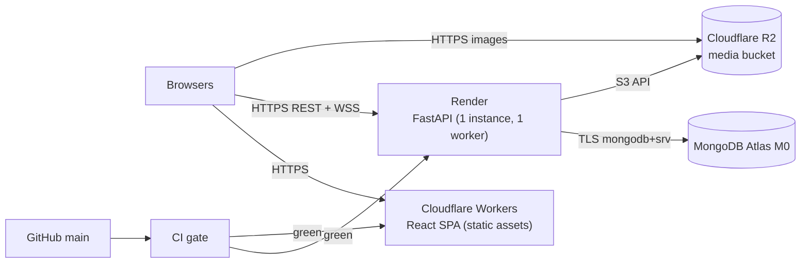
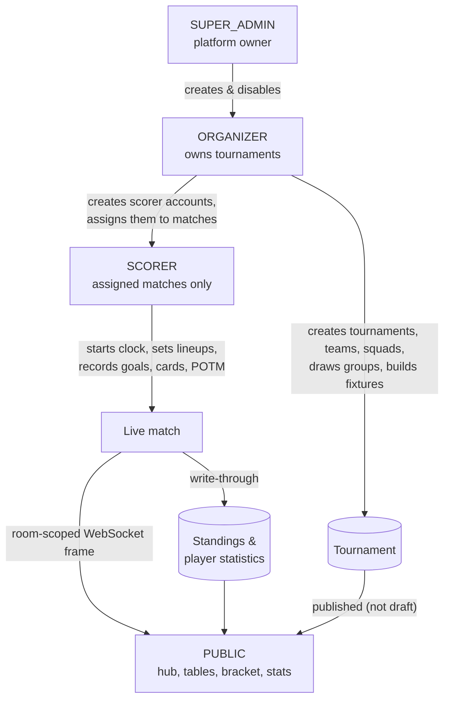
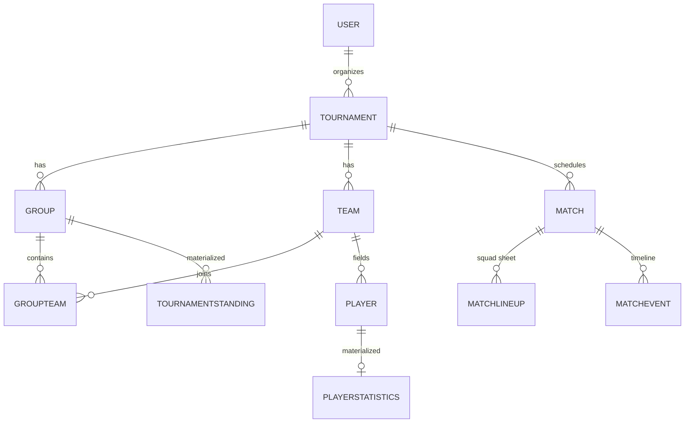

# MatchGrid: Live Football Tournament Platform

A multi-tenant SaaS for running football tournaments end to end: organizers create competitions and draw groups, scorers run matches live from a pitch-side console, and the public follows scores, tables, brackets and leaderboards in real time.

| | |
|---|---|
| **Live app** | https://matchgrid.rajeshhabra100.workers.dev/ |
| **Live API** | https://matchgrid-api.onrender.com/ (health: `/health`) |
| **Stack** | FastAPI · MongoDB (Beanie) · React 18 + Vite · Cloudflare Workers · Render · Atlas · Cloudflare R2 |
| **Quality gate** | 639 automated tests (`bun run test:all`: Pytest, Vitest, production build, Playwright E2E) |

> The free-tier API on Render sleeps when idle: the first request after a quiet period can take about 30 seconds.

---

## The problem

Amateur and community leagues run on spreadsheets and group chats. Scores arrive late, tables are recalculated by hand, brackets are drawn on whiteboards, and nobody outside the venue can follow a match. MatchGrid replaces that with one system where a goal entered on a phone at the pitch side updates every viewer's screen within a second, and where several organizers can run their own competitions on the same platform without seeing each other's data.

## Architecture highlights

| Highlight | How it works |
|---|---|
| **4-tier RBAC with tenant isolation** | `SUPER_ADMIN` → `ORGANIZER` → `SCORER` → `PUBLIC`. Organizers only reach tournaments they own (`organizer_id`), scorers only matches assigned to them, and the public never sees `draft` tournaments. Enforced in FastAPI dependencies (`core/deps.py`), not in the UI. |
| **Write-through materialized views** | Group standings (`TournamentStanding`) and player statistics (`PlayerStatistics`) are recomputed inside the same request as the event, lineup or result that changed them, so reads are a plain indexed lookup and never recompute. |
| **Room-scoped WebSocket invalidation** | Clients subscribe to a tournament or match room; a mutation broadcasts a small invalidation frame only to that room and clients refetch through the normal REST path. |
| **Drift-free UTC match clock** | The server stores `started_at` / `elapsed_seconds` / `is_half_time`, with no background timers. Every client derives the same minute from the UTC timestamps, and the clock survives restarts, pauses at half time and resumes exactly. |
| **O(1) batched queries** | Lists of matches, scores and statistics are built from one batched `$in` query plus an in-memory pass, not a query per row. A test asserts the query count does not grow with the number of matches. |
| **Dynamic tournament engine** | Configurable groups, points rules and knockout format (`none`, `semis_final`, `quarters_semis_final`). Circle-method fixtures, deterministic tiebreakers, cross-group bracket seeding, penalty-shootout winners and a derived tournament stage / champion. |
| **Cloudflare R2 asset lifecycle** | Uploads go browser → API → R2 (the browser never holds credentials). Pillow validates magic bytes, size and dimensions; keys are `tournaments/<id>/<category>/<uuid>.<ext>`; deleting a tournament purges its R2 folder after the database rows. |
| **Production hardening** | In production the API refuses to boot with placeholder secrets, wildcard CORS, a local database or missing R2 settings. Login throttling keys on a trusted client IP header, and the API runs as a single process so the in-memory WebSocket rooms stay correct. See [`DEPLOYMENT.md`](DEPLOYMENT.md). |

### System architecture



### Roles and workflow



### Data model



Compound and partial-unique indexes keep tenants honest: `(tournament_id, match_number)`, `(tournament_id, name)` for teams, `(team_id, number)` and per-tournament `player_code` / `dcl_id` for players, `(match_id, player_id)` for lineups, and `(group_id, team_id)` for standings. Full detail in [`docs/system_architecture.md`](docs/system_architecture.md).

---

## Try the demo

The repository ships with a **showcase seeder** that fills the product with four tournaments, four named accounts and real generated artwork, so every page has something on it.

```bash
bun run setup            # one-time: Docker Mongo, Python venv, Bun packages, migrations
bun run seed:showcase    # builds the showcase (safe to re-run)
bun run dev              # http://localhost:5173
```

The same thing from the original seeder entry point: `cd apps/backend && ./.venv/bin/python -m app.scripts.seed_realistic_demo --showcase`.

### What gets created

| Tournament | Owner | State | What you will see |
|---|---|---|---|
| **Apex Champions Cup 2026** | Apex Football League | active, **knockout** | 8 clubs in 2 groups of 4, complete group tables, all four quarter-finals played (one on penalties), one semi-final done and one **live** with a running clock, a second live friendly, leaderboards for goals, assists, discipline and POTM |
| **Metro Premier League 2026** | Metro Premier Cup | active, **group stage** | 6 clubs in 2 groups of 3, mid-table results, 1 **live** match, upcoming fixtures |
| **Winter Invitational 2025** | Apex Football League | **completed** | Full group stage, semi-finals and final, crowned champion, full match event timelines |
| **Summer Youth Super Cup 2026** | Metro Premier Cup | **draft** | Visible only to its organizer and the superadmin: demonstrates multi-tenant draft privacy |

**Bracket seeding rule.** Apex Champions Cup uses the `quarters_semis_final` format with `qualifiers_per_group = 4`: with two groups of four, *every* team advances, so the group tables decide the seeding and the quarter-finals pair the eight teams in a cross-group fold (1st-seed v 8th, and so on). The quarter-final format needs at least 8 qualifiers, which is why this configuration is the one that fits an 8-club, 2-group event.

Every played fixture has a squad sheet (7 starters plus bench) and chronological goal / assist / yellow / red / POTM events. Standings, player statistics, bracket progression and the tournament stage are produced by the application's own services, not written directly, and the seeder cross-checks them before it reports success.

Crests, jersey portraits, logos and banners are drawn with Pillow (eight crest templates in each club's colours, numbered jersey portraits in team colours), so there are no placeholder boxes anywhere.

### Demo logins

Every showcase account uses the password **`DemoPass#2026`**. This is a local demo password: it is not the production superadmin's.

| Role | Username | Organization | Portal | What to look at |
|---|---|---|---|---|
| Organizer | `alex.organizer` | Apex Football League | `/organizer` | Apex Champions Cup + Winter Invitational: fixtures, teams and squads, scorers, settings |
| Organizer | `priya.organizer` | Metro Premier Cup | `/organizer` | Metro Premier League + the private draft Youth Cup |
| Scorer | `sam.scorer` | Apex Football League | `/scorer` | Assigned Apex fixtures; open the live semi-final to run the clock and add events |
| Scorer | `maya.scorer` | Metro Premier Cup | `/scorer` | Assigned Metro fixtures, including the live match |
| Superadmin | *your configured account* | | `/superadmin` | All tenants, user management, platform stats |

The public pages (`/`, `/t/<slug>/…`) need no login. Log in as `priya.organizer` to see the draft tournament that the public hub hides.

### Seeder options

```bash
cd apps/backend
./.venv/bin/python -m app.scripts.seed_showcase                    # build (idempotent; re-run re-anchors live clocks)
./.venv/bin/python -m app.scripts.seed_showcase --dry-run          # report only
./.venv/bin/python -m app.scripts.seed_showcase --reset-showcase   # remove only showcase data, rebuild
./.venv/bin/python -m app.scripts.seed_showcase --media r2         # upload artwork to R2 instead of embedding it
```

* **Idempotent.** Content is keyed by slug and username, so a re-run creates nothing new. Existing tournaments are skipped. The "live right now" matches are re-anchored on each run so their clocks keep ticking realistically; run it again whenever the live matches get stale.
* **Safe by default.** Artwork is embedded in MongoDB as data URIs (`--media inline`) and nothing is written to R2. It refuses a database whose name contains `test`, and refuses `ENVIRONMENT=production` or any non-local MongoDB unless `--allow-production` is passed. It never creates or changes the superadmin, and `--reset-showcase` removes only the four showcase accounts and their tournaments.
* **Live deployment (deliberate, opt-in).** Point `MONGO_URI` / `R2_*` at the production services and add `--allow-production --media r2` (plus `--reset-showcase` to rebuild). Artwork is then uploaded through the same `StorageService` the app uses, so the stored URLs are real R2 CDN URLs.
* The older `bun run seed:demo` (about 50 generic tournaments for volume testing) is unchanged.

---

## Quick start

Prerequisites: Docker, Bun ≥ 1.1, Python 3.12+ (3.14 recommended).

```bash
bun run setup     # copies .env templates, starts Mongo 7 in Docker, creates the venv, installs deps, runs migrations
bun run dev       # Mongo + FastAPI (reload) on :8001 + Vite on :5173, with prefixed live logs
```

| URL | |
|---|---|
| Web app | http://localhost:5173 |
| API health | http://localhost:8001/health · `/health/db` |
| OpenAPI docs | http://localhost:8001/docs (development only) |

### Commands

| Command | Action |
|---|---|
| `bun run setup` | Bootstrap: Docker Mongo, Python `.venv`, Bun packages, migrations |
| `bun run dev` | Mongo + backend (`:8001`) + frontend (`:5173`) |
| `bun run seed:showcase` | Four-tournament showcase with accounts and artwork |
| `bun run seed:demo` | ~50 generic tournaments (volume demo) |
| `bun run test` | Pytest + Vitest |
| `bun run test:e2e` | Playwright multi-role E2E |
| `bun run test:all` | **Full quality gate**: Pytest + Vitest + production build + Playwright |
| `bun run build` | Production Vite bundle in `apps/frontend/dist` |
| `bun run db:up` / `db:down` | Start / stop the MongoDB container |

Ports: MongoDB on host `27018` (container `27017`, volume `mongo_data`), backend `8001`, frontend `5173` (proxies `/api` and `/ws`).

---

## Repository layout

```
MatchGrid/
├── apps/
│   ├── backend/            # FastAPI REST + WebSocket server
│   │   ├── app/            # core/, models/, routers/, schemas/, services/, migrations/, scripts/
│   │   └── tests/          # Pytest suite (real MongoDB test database, no mocks of the data layer)
│   └── frontend/           # React 18 + Vite SPA (hub, tournament pages, organizer / scorer / superadmin portals)
├── e2e/                    # Playwright specs: auth, RBAC isolation, live lifecycle, uploads, brackets, draft privacy
├── docs/                   # plan, architecture, roadmap, development workflow
├── infra/mongo/            # MongoDB container setup
├── scripts/                # setup, db-up, live production audit and smoke scripts
└── docker-compose.yml      # MongoDB 7 only
```

## Testing

`bun run test:all` is the merge gate: backend Pytest (469 tests against a disposable `matchgrid_test` database, never the dev database), frontend Vitest (152 tests), a production Vite build, and Playwright (18 browser tests across the four roles). The seeder has its own tests and runs only against the test database.

## Deployment

Cloudflare Workers (SPA) → Render (single FastAPI container) → MongoDB Atlas M0, with media in Cloudflare R2. Every environment variable, the production boot checks and the verification scripts are in [`DEPLOYMENT.md`](DEPLOYMENT.md).

## Documentation

- [`docs/plan.md`](docs/plan.md): master project plan and role model
- [`docs/system_architecture.md`](docs/system_architecture.md): architecture, RBAC, data model, clock and bracket engines, WebSockets
- [`docs/IMPLEMENTATION_ROADMAP.md`](docs/IMPLEMENTATION_ROADMAP.md): phased roadmap
- [`docs/DEVELOPMENT_WORKFLOW.md`](docs/DEVELOPMENT_WORKFLOW.md): lifecycle and quality gates
- [`docs/PROJECT_ANALYSIS.md`](docs/PROJECT_ANALYSIS.md): historical baseline audit
