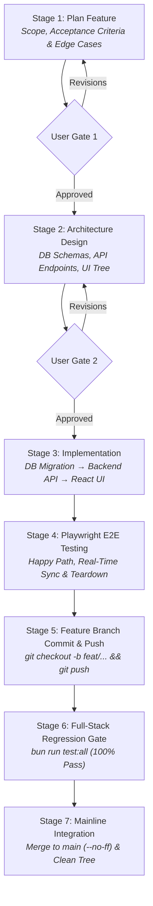

# MatchGrid Standardized Development & Testing Workflow

This document codifies the mandatory 7-stage feature development lifecycle and verification standards for **MatchGrid**. All contributors, automated agents, and CI pipelines adhere strictly to these gates.

---

## 1. Monorepo Architecture & Verification Gates

The MatchGrid codebase is organized as a unified Bun monorepo:
- **`apps/backend/`**: FastAPI REST API, Motor/Beanie ODM, WebSocket engine, Pytest suite.
- **`apps/frontend/`**: React 18, Vite, React Router, Vitest component test suite.
- **`e2e/`**: Playwright end-to-end integration test suite.

### Unified Verification Commands
| Command | Execution Scope | Target Artifacts |
| :--- | :--- | :--- |
| `bun run dev` | Spins up MongoDB (Docker), FastAPI (`:8001`), and Vite (`:5173`) concurrently. | Local active environment |
| `bun run test:backend` | Executes Pytest with asyncio test isolation against disposable test database. | `apps/backend/tests/` |
| `bun run test:frontend` | Executes Vitest unit & component test suite. | `apps/frontend/src/**/*.test.jsx` |
| `bun run test:e2e` | Headless Playwright test suite against running backend & frontend. | `e2e/tests/*.spec.ts` |
| `bun run test:e2e:ui` | Interactive Playwright UI Mode with time-travel debugger and DOM locator inspector. | Developer browser UI |
| `bun run test:all` | **Mandatory Full-Stack Quality Gate**: Sequential run of Backend Pytest + Frontend Vitest + Frontend Build + Playwright E2E. | Complete project verification |

---

## 2. The 7-Stage Feature Lifecycle



---

### Stage 1: Feature Planning
1. **Define Objective & Scope**: Clarify who the feature serves (Tournament Organizer, Match Scorer, or Spectator).
2. **Formulate Acceptance Criteria**: Concrete Given-When-Then rules.
3. **Analyze Edge Cases**: Address race conditions, network failures, empty database states, and permission boundaries.
4. **Interactive Gate**: Present the Feature Plan artifact and pause for user approval before drafting technical designs.

### Stage 2: Architecture & System Design
1. **Database Layer (MongoDB / Beanie)**:
   - Schema modifications, types, defaults, and compound indexes.
   - Design forward migrations in `apps/backend/app/migrations/mXXXX_<description>.py`.
2. **Backend API & WebSocket Contracts**:
   - Pydantic models in `apps/backend/app/schemas/`.
   - Endpoints in `apps/backend/app/routers/` with appropriate auth boundaries (`get_current_admin`).
   - Real-time broadcast messages in `apps/backend/app/core/websocket.py`.
3. **Frontend Component Tree & Styling**:
   - React components in `apps/frontend/src/components/` and routes in `apps/frontend/src/pages/`.
   - Adhere strictly to the Deep Stadium Slate (`#0B0F14`) and Pitch Emerald (`#10B981`) design tokens.
4. **Interactive Gate**: Present the Technical Design artifact and pause for user approval before modifying code.

### Stage 3: Layered Implementation (DB → Backend → Frontend)
1. **Database Migration & Models**: Update Beanie models and migration scripts.
2. **Backend Logic & Pytest Suite**: Implement services, routers, and write unit/integration tests in `apps/backend/tests/`. Verify via `bun run test:backend`.
3. **Frontend Components & Vitest Suite**: Implement API clients, components, and component tests in `apps/frontend/src/`. Verify via `bun run test:frontend`.

### Stage 4: Playwright E2E Testing
1. Author end-to-end test specs in `e2e/tests/<order>-<feature-slug>.spec.ts`.
2. Utilize `e2e/fixtures/api.ts` for clean entity generation (teams, players, matches).
3. **Mandatory Teardown**: Always call `teardownEntities()` in `finally` blocks so zero temporary test entities leak into persistent databases.
4. Run `bun run test:e2e` to verify 100% pass rate.

### Stage 5: Feature Branch Commit & Push
1. Branch from `main`:
   ```bash
   git checkout -b feat/<feature-slug>
   ```
2. Commit with conventional commit messages:
   ```bash
   git commit -m "feat(<scope>): <concise explanation>"
   ```
3. Push to origin:
   ```bash
   git push -u origin feat/<feature-slug>
   ```

### Stage 6: Full-Stack Regression Gate
Execute the full automated verification gate:
```bash
bun run test:all
```
All four gates must pass with zero failures:
- [x] Backend Pytest Suite
- [x] Frontend Vitest Suite
- [x] Frontend Production Bundle Build
- [x] Playwright E2E Test Suite

### Stage 7: Mainline Integration
1. Merge into `main` without fast-forwarding to preserve audit history:
   ```bash
   git checkout main
   git pull origin main
   git merge --no-ff feat/<feature-slug> -m "feat: merge <feature-slug> into main"
   git push origin main
   ```
2. Verify clean git status:
   ```bash
   git status
   ```

---

## 3. Branching & Commit Conventions
- **Feature Branches**: `feat/<short-name>`
- **Bug Fix Branches**: `fix/<issue-name>`
- **Refactoring Branches**: `refactor/<scope>`
- **Hotfix Branches**: `hotfix/<patch-name>`

Never push broken tests or failing builds to `main`. Every merge to `main` must pass `bun run test:all`.
