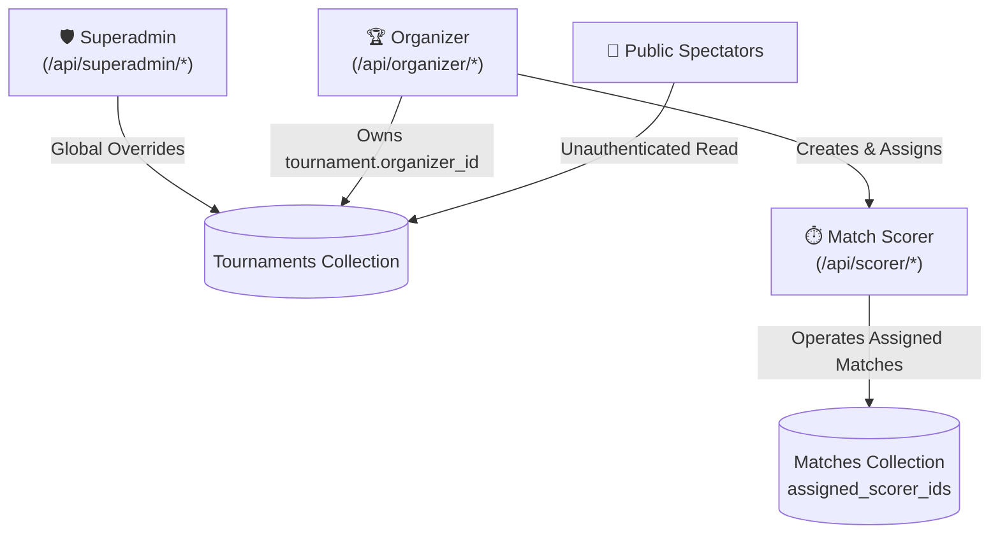
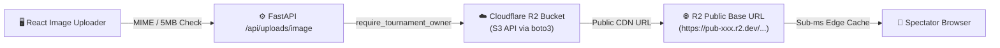
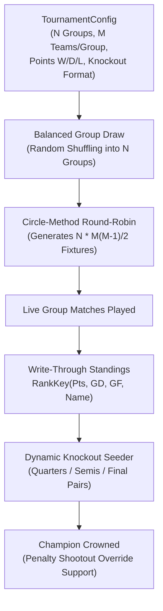
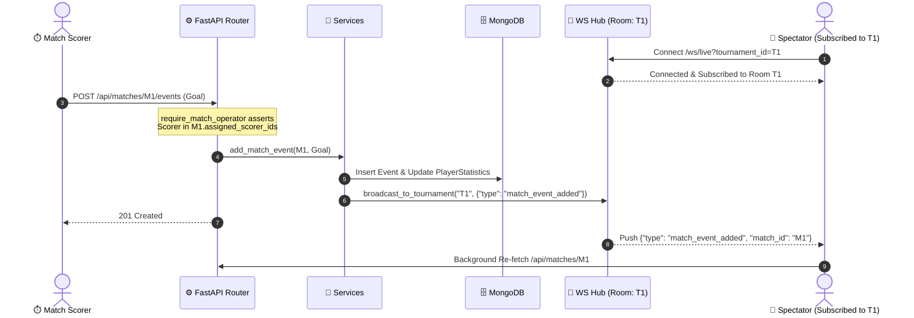
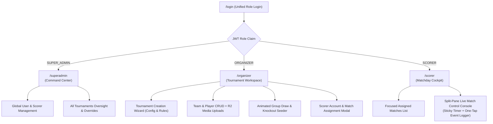
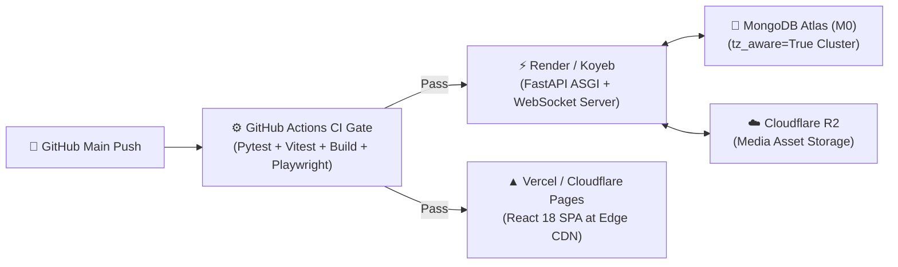
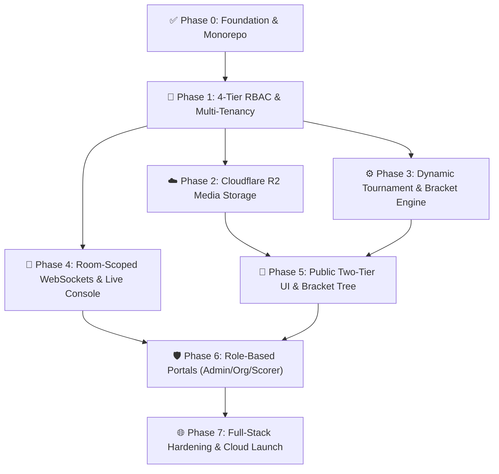

# MatchGrid — Phased Implementation Blueprint & Master Roadmap

**Document Version:** 1.0.0  
**Target Path:** `docs/IMPLEMENTATION_ROADMAP.md`  
**System Name:** MatchGrid (Multi-Tenant Live Football SaaS Platform)  
**Standard Lifecycle:** [docs/DEVELOPMENT_WORKFLOW.md](file:///home/rajesh/Placement_Project/DCL_score_board/docs/DEVELOPMENT_WORKFLOW.md)  
**System Architecture:** [docs/system_architecture.md](file:///home/rajesh/Placement_Project/DCL_score_board/docs/system_architecture.md)  
**Master Plan:** [docs/plan.md](file:///home/rajesh/Placement_Project/DCL_score_board/docs/plan.md)  

---

## Quick-Reference Phase Execution Tracker

| Phase # | Phase Title | Core Scope & Deliverables | Quality Gates & Verification | Status |
| :---: | :--- | :--- | :--- | :---: |
| **Phase 0** | **Monorepo, Docker & Rebranding** | Bun workspace monorepo, MongoDB 7 Docker, MatchGrid brand tokens (`index.css`), Playwright setup, empty DB seed slate. | Pytest (253) + Vitest (34) + Build + E2E (7) | **COMPLETED** |
| **Phase 1** | **4-Tier RBAC & Multi-Tenancy** | Unified `User` model (`SUPER_ADMIN`, `ORGANIZER`, `SCORER`), `Tournament.organizer_id` & `slug`, compound indexes, `Match.assigned_scorer_ids`, migration `m0005`, FastAPI RBAC guards. | Pytest (259) + Vitest (38) + Build + Playwright (8) | **COMPLETED** |
| **Phase 2** | **Cloudflare R2 Media Storage** | S3-compatible `boto3` R2 client, MIME/size validation, upload & cleanup API (`/api/uploads/image`), R2 image rendering for Tournaments, Teams & Players, React upload UI. | Pytest (272) + Vitest (45) + Build + Playwright (9) | **COMPLETED** |
| **Phase 3** | **Dynamic Tournament Engine** | Configurable `TournamentConfig`, circle-method round-robin scheduler, dynamic knockout seeding (Semis/Quarters/R16), penalty shootout winner overrides. | Pytest (284) + Vitest (50) + Build + Playwright (10) | **COMPLETED** |
| **Phase 4** | **Room WebSockets & Scorer Console** | Room-partitioned `ConnectionManager` (`/ws/live?tournament_id=...`), scorer match scoping (`GET /api/scorer/matches`), `require_match_operator` live clock & event locks. | Pytest WS rooms + Vitest ticker + Playwright multi-tab live sync | **READY TO START** |
| **Phase 5** | **Public Two-Tier UI & Bracket Tree** | Global Discovery Header + `/t/:slug/*` Context Sub-Navbar + mobile drawer, Tournament Hub (`/`), Match Center, Standings, Visual Knockout Bracket Tree, R2 Media squads. | Vitest components + Playwright public browsing | **PLANNED** |
| **Phase 6** | **Dedicated Role Portals** | Superadmin Command Center (`/superadmin`), Organizer Workspace (`/organizer`), Scorer Cockpit (`/scorer`) + Live Match Console, unified role-based `/login`. | Vitest portals + Playwright multi-role full lifecycle | **PLANNED** |
| **Phase 7** | **CI/CD Hardening & Cloud Launch** | Complete E2E regression suite, GitHub Actions CI matrix, production safety checks (`production_safety.py`), deployment to Atlas (M0) + Render + Vercel + R2. | `bun run test:all` (100% pass) + Cloud smoke checks | **PLANNED** |

---

## 1. Current Baseline & Gap Audit

### 1.1 Verified Baseline (Phase 0 Completed)
- **Monorepo & Build Tooling:** Unified Bun workspace monorepo (`apps/backend`, `apps/frontend`, `e2e`, `docs`, `scripts`) with single-command developer setup (`bun run dev`).
- **Database Isolation:** Containerized MongoDB 7.0 via Docker (`matchgrid_mongo`), mapped to host port `27018` to eliminate local port conflicts, with automated healthchecks.
- **Brand Identity & Design Tokens:** Complete overhaul in `apps/frontend/src/index.css` featuring Deep Stadium Slate (`#0B0F14` canvas, `#131A22` cards, `#1C2530` panels), Pitch Emerald (`#10B981`), Broadcast Crimson (`#EF4444`), Champion Gold (`#F59E0B`), and tabular numeral classes (`tabular-nums`) for jitter-free live match telemetry.
- **Testing Baseline:** 100% green full-stack quality gate:
  - **Pytest:** 253 passed tests across backend models, auth boundaries, batching, and match timers.
  - **Vitest:** 34 passed component tests for rendering, live controls, and navigation.
  - **Frontend Build:** Verified Vite asset bundling in 1.42s with zero errors.
  - **Playwright E2E:** 7 passed browser tests covering public smoke, admin login, and live match scoring.
- **Cloudflare R2 Media Infrastructure Readiness:** Cloudflare R2 bucket provisioned, S3 API credentials generated (`R2_ACCOUNT_ID`, `R2_ACCESS_KEY_ID`, `R2_SECRET_ACCESS_KEY`, `R2_BUCKET_NAME`, `R2_PUBLIC_BASE_URL`), CORS enabled for web uploads.

### 1.2 Exact Architecture & Feature Gaps Remaining
1. **User & Identity Schema:** Currently has only a single `Admin` collection (`admins`). Lacks a unified `users` collection with 4-tier roles (`SUPER_ADMIN`, `ORGANIZER`, `SCORER`).
2. **Tenant Scoping & Indexes:** `Tournament` is currently a singleton document (`Tournament.find_one()`). Teams have a globally unique `name` index (preventing two tournaments from sharing team names). `Player` has a legacy collection-wide unique `dcl_id` and lacks `tournament_id`. `Match` lacks `assigned_scorer_ids`.
3. **Media Hosting Pipeline:** Static team logos currently reside on local frontend disk (`frontend/public/assets/teams/`). Player headshots and tournament banners do not exist. There is no automated, validated S3/R2 upload and deletion pipeline.
4. **Scheduling & Knockout Engine:** Fixture generation is hardcoded to 6 teams and 2 groups of 3 (`len(group_teams) != 3`). Bracket progression hardcodes $A_2 \text{ vs } B_1$ and $B_2 \text{ vs } A_1$ semi-finals; Quarter-Finals and custom point rules are unbuilt.
5. **Real-Time Telemetry:** `ConnectionManager` maintains a single global set of WebSocket connections. Connections cannot subscribe to a specific `tournament_id` room.
6. **Frontend Routes & Navigation:** The frontend is a flat single-tournament app (`/matches`, `/standings`, `/admin`). Lacks two-tier tournament scoping (`/t/:slug/...`) and dedicated role portals (`/superadmin`, `/organizer`, `/scorer`).

---

## 2. Phased Breakdown & 7-Stage Lifecycle Execution Matrix

Every phase detailed below is an autonomous, incremental milestone that executes strictly through the **7-Stage Feature Development Lifecycle** codified in [docs/DEVELOPMENT_WORKFLOW.md](file:///home/rajesh/Placement_Project/DCL_score_board/docs/DEVELOPMENT_WORKFLOW.md).

---

### Phase 1: Four-Tier RBAC & Multi-Tenant Data Isolation (COMPLETED)

#### Objective
Transition the database and API from a single-admin singleton tournament into a multi-tenant platform with four distinct operational tiers: **Superadmin** (platform governance), **Tournament Organizer** (tenant owner), **Match Scorer** (matchday operator), and **Public Spectator** (read-only).



#### Lifecycle Execution Matrix (Stages 1 – 7)

##### Stage 1 — Plan Feature (Gate 1)
- **Target Roles:** `SUPER_ADMIN`, `ORGANIZER`, `SCORER`, `PUBLIC`.
- **Acceptance Criteria (Given-When-Then):**
  - *Given* an authenticated `ORGANIZER`, *when* creating or querying tournaments, *then* they only see tournaments where `tournament.organizer_id == current_user.id`.
  - *Given* an authenticated `SCORER`, *when* requesting `/api/scorer/matches`, *then* only matches containing `current_user.id` in `match.assigned_scorer_ids` are returned.
  - *Given* a user with role `SCORER`, *when* attempting to access `/api/organizer/*` or modify an unassigned match, *then* the API returns `403 Forbidden`.
  - *Given* a `SUPER_ADMIN`, *when* accessing any tournament, user, or match endpoint, *then* all ownership filters are bypassed.
- **Edge Cases & Failure Modes:**
  - Token expiration during a live match (graceful 401 prompt with zero data loss).
  - Organizer attempts to assign a scorer created by another organizer (blocked by `scorer.created_by == current_user.id`).
  - Test suite backward compatibility: ensure `apps/backend/tests/conftest.py` provisions a default tournament and organizer so the 253 existing Pytests remain green throughout the refactoring.

##### Stage 2 — Architecture & System Design (Gate 2)
- **Database Models & Compound Indexes (`apps/backend/app/models/`):**
  - `User`: `username` (unique), `email` (sparse unique), `password_hash`, `role` (`SUPER_ADMIN` \| `ORGANIZER` \| `SCORER`), `organization_name`, `created_by`, `is_active`.
  - `Tournament`: Add `organizer_id: PydanticObjectId`, `slug: str` (unique, indexed).
  - `Team`: Change `name` index to compound: `IndexModel([("tournament_id", 1), ("name", 1)], unique=True)`.
  - `Player`: Add `tournament_id: PydanticObjectId`. Remove legacy `dcl_id` unique index. Add compound index: `IndexModel([("tournament_id", 1), ("team_id", 1), ("number", 1)], unique=True)`.
  - `Match`: Add `assigned_scorer_ids: list[PydanticObjectId] = []`. Keep `team1_id`/`team2_id` and `winner_override_id` (aliased as home/away in schemas).
- **Forward Migration (`apps/backend/app/migrations/m0005_multi_tenant_rbac.py`):**
  - Creates the default `SUPER_ADMIN` user from `ADMIN_BOOTSTRAP_USERNAME` / `ADMIN_BOOTSTRAP_PASSWORD`.
  - Backfills existing `Tournament` documents with the superadmin's ID as `organizer_id` and generates initial URL slugs.
- **FastAPI Dependency Guards (`apps/backend/app/core/deps.py`):**
  - `get_current_user`: Decodes JWT, validates user activity.
  - `require_superadmin`: Asserts `current_user.role == UserRole.SUPER_ADMIN`.
  - `require_tournament_owner(tournament_id)`: Asserts `SUPER_ADMIN` or `ORGANIZER` ownership.
  - `require_match_operator(match_id)`: Asserts `SUPER_ADMIN`, owning `ORGANIZER`, or assigned `SCORER`.
- **API Endpoints:**
  - `/api/auth/login`: Issues role-embedded JWTs.
  - `/api/superadmin/users`: CRUD for Organizers & Scorers.
  - `/api/organizer/scorers`: Scorer user creation & listing for tenant organizers.
  - `/api/organizer/matches/{id}/scorers`: Assign/unassign scorers to matches.

##### Stage 3 — Layered Implementation (DB $\to$ Backend $\to$ Frontend)
1. **DB Layer:**
   - Create `apps/backend/app/models/user.py` and register in `DOCUMENT_MODELS`.
   - Update `Tournament`, `Team`, `Player`, and `Match` models.
   - Author and run `apps/backend/app/migrations/m0005_multi_tenant_rbac.py`.
2. **Backend API Layer:**
   - Implement RBAC guards in `apps/backend/app/core/deps.py`.
   - Create routers `apps/backend/app/routers/superadmin.py` and `apps/backend/app/routers/organizer.py`.
   - Write comprehensive Pytest suite in `apps/backend/tests/test_rbac_isolation.py`.
   - Run `bun run test:backend` (Verify all 253+ tests pass).
3. **Frontend API Layer:**
   - Update `apps/frontend/src/api/auth.js` to store decoded user role and user ID.
   - Update `apps/frontend/src/routes/AppRouter.jsx` with `<RoleGuard role="...">`.
   - Run `bun run test:frontend`.

##### Stage 4 — Playwright E2E Testing
- Create `e2e/tests/04-rbac-isolation.spec.ts`:
  - Superadmin logs in $\to$ creates Organizer account $\to$ verifies Organizer portal.
  - Organizer logs in $\to$ attempts to access `/api/superadmin/users` $\to$ receives 403.
  - Organizer creates Scorer $\to$ assigns Scorer to Match 1 $\to$ Scorer logs in and sees only Match 1.
  - Scorer attempts to modify Match 2 $\to$ blocked by UI and API.
  - Mandatory teardown via `teardownEntities()` in `finally` block.
- Verify: `bun run test:e2e`.

##### Stage 5 — Feature Branch Commit & Push
- `git checkout -b feat/phase-1-rbac-multitenancy`
- `git commit -m "feat(auth): implement 4-tier RBAC and multi-tenant data isolation"`
- `git push -u origin feat/phase-1-rbac-multitenancy`

##### Stage 6 — Full-Stack Regression Gate
- Execute `bun run test:all` (Pytest + Vitest + Build + Playwright = 100% Pass).

##### Stage 7 — Mainline Integration
- `git checkout main && git merge --no-ff feat/phase-1-rbac-multitenancy -m "feat: merge phase 1 RBAC and multi-tenancy"`
- `git push origin main`

---

### Phase 2: Cloudflare R2 Media Storage & Asset Upload Pipeline (COMPLETED)

#### Objective
Integrate an industry-standard, zero-cost cloud asset hosting pipeline using Cloudflare R2 (S3-compatible API) to support image uploads, thumbnail generation/fallbacks, and automatic deletion of replaced or orphaned media.



#### Lifecycle Execution Matrix (Stages 1 – 7)

##### Stage 1 — Plan Feature (Gate 1)
- **Target Roles:** `SUPER_ADMIN`, `ORGANIZER`, `PUBLIC`.
- **Acceptance Criteria (Given-When-Then):**
  - *Given* an authenticated Organizer, *when* uploading a team crest or tournament banner (JPEG/PNG/WebP, $\le 5\text{ MB}$), *then* the file is stored in Cloudflare R2 under key `tournaments/<t_id>/<category>/<uuid>.<ext>` and returns the public CDN URL.
  - *Given* an invalid file (SVG containing script, executable, or file $> 5\text{ MB}$), *then* the API rejects the upload with `422 Unprocessable Entity` or `413 Payload Too Large`.
  - *Given* a player without a headshot, *when* rendered on the frontend, *then* the UI displays a clean initials avatar with the team's accent color background.
  - *Given* a team crest is replaced or a team is deleted, *then* the old R2 object is automatically deleted to prevent cloud storage bloat.
- **Edge Cases & Failure Modes:**
  - Network disconnect during S3 upload (fast retry with exponential backoff).
  - Malformed file extensions (magic byte inspection via `filetype` or Python standard library).

##### Stage 2 — Architecture & System Design (Gate 2)
- **Dependencies (`apps/backend/requirements.txt`):**
  - Add `boto3==1.36.21` (or `aioboto3`) for S3-compatible client calls.
  - Add `pillow==11.1.0` for image dimension validation and sanitization.
- **Configuration (`apps/backend/app/core/config.py`):**
  - `r2_account_id: str`
  - `r2_access_key_id: str`
  - `r2_secret_access_key: str`
  - `r2_bucket_name: str`
  - `r2_public_base_url: str`
- **Domain Service (`apps/backend/app/services/storage.py`):**
  - `upload_file(file_bytes, content_type, key) -> str`
  - `delete_file(key) -> bool`
  - `extract_key_from_url(url) -> str`
- **API Endpoints (`apps/backend/app/routers/uploads.py`):**
  - `POST /api/uploads/image`: Validates MIME type, dimensions, and writes to R2.
  - `DELETE /api/uploads/image`: Removes an asset from R2.
- **Frontend Components:**
  - `apps/frontend/src/components/common/ImageUploader.jsx`: Drag-and-drop, client-side thumbnail preview, upload progress spinner, and error banner.
  - `apps/frontend/src/components/common/Avatar.jsx`: Renders player photo from R2 URL with graceful fallback to team-colored initials badge.

##### Stage 3 — Layered Implementation (DB $\to$ Backend $\to$ Frontend)
1. **DB & Models:**
   - Add `banner_url: Optional[str] = None` and `logo_url: Optional[str] = None` to `Tournament`.
   - Update `Team.crest_url` and `Player.photo_url` to store full HTTPS R2 URLs.
2. **Backend API:**
   - Implement `storage.py` and mount `uploads.py` router.
   - Hook automatic R2 cleanup on `Team.delete()` and `Player.delete()`.
   - Write Pytest unit & mock tests in `apps/backend/tests/test_storage_service.py` (mocking `boto3.client("s3")`).
   - Run `bun run test:backend`.
3. **Frontend UI:**
   - Build `ImageUploader.jsx` with Vitest tests (`ImageUploader.test.jsx`).
   - Run `bun run test:frontend`.

##### Stage 4 — Playwright E2E Testing
- Create `e2e/tests/05-media-uploads.spec.ts`:
  - Organizer uploads a real PNG crest for a test team.
  - Verifies image loads with 200 OK from the public R2 URL in the DOM.
  - Deletes the test team and verifies cleanup.
- Verify: `bun run test:e2e`.

##### Stage 5 — Feature Branch Commit & Push
- `git checkout -b feat/phase-2-r2-media-pipeline`
- `git commit -m "feat(media): integrate Cloudflare R2 storage and upload pipeline"`
- `git push -u origin feat/phase-2-r2-media-pipeline`

##### Stage 6 — Full-Stack Regression Gate
- Execute `bun run test:all` (Pytest + Vitest + Build + Playwright = 100% Pass).

##### Stage 7 — Mainline Integration
- `git checkout main && git merge --no-ff feat/phase-2-r2-media-pipeline -m "feat: merge phase 2 R2 media storage"`
- `git push origin main`

---

### Phase 3: Dynamic Tournament, Group Draw & Knockout Bracket Engine (COMPLETED)

#### Objective
Replace hardcoded 6-team / 2-group logic with a generalized tournament engine supporting configurable group sizes, circle-method round-robin fixture generation, customizable points rules, and dynamic knockout bracket progression (Quarter-Finals $\to$ Semi-Finals $\to$ Final).



#### Lifecycle Execution Matrix (Stages 1 – 7)

##### Stage 1 — Plan Feature (Gate 1)
- **Target Roles:** `ORGANIZER`, `SCORER`, `PUBLIC`.
- **Acceptance Criteria (Given-When-Then):**
  - *Given* an Organizer configuring a tournament with 4 groups of 4 teams ($16$ teams), *when* clicking "Generate Fixtures", *then* exactly $6$ round-robin matches per group ($24$ total) are scheduled with alternating home/away pairs.
  - *Given* custom point rules ($4$ for Win, $2$ for Draw, $0$ for Loss), *when* group matches complete, *then* `TournamentStanding` accurately reflects points using the custom weights.
  - *Given* a tournament with `knockout_format: "quarters_semis_final"`, *when* all group matches reach `full_time`, *then* 4 Quarter-Final fixtures are automatically generated pairing $A_1 \text{ vs } B_2$, $C_1 \text{ vs } D_2$, etc.
  - *Given* a knockout match ending level, *when* the Scorer or Organizer records a penalty shootout winner (`winner_override_id`), *then* that team advances to the downstream bracket slot.
- **Edge Cases & Failure Modes:**
  - Odd number of teams in a group (scheduler injects virtual `BYE` slot).
  - Regenerating fixtures for a group with existing match results (blocked unless `force=true` with explicit confirmation).

##### Stage 2 — Architecture & System Design (Gate 2)
- **Models (`apps/backend/app/models/tournament.py`):**
  - Add `TournamentConfig` embedded document:
    ```python
    class TournamentConfig(BaseModel):
        num_groups: int = 2
        teams_per_group: int = 4
        qualifiers_per_group: int = 2
        knockout_format: Literal["none", "semis_final", "quarters_semis_final"] = "semis_final"
        points_win: int = 3
        points_draw: int = 1
        points_loss: int = 0
        half_duration_minutes: int = 45
    ```
- **Scheduling Algorithms (`apps/backend/app/services/`):**
  - `groups.py`: Generalized `random_draw(tournament_id)` distributing $T$ teams evenly across $N$ groups.
  - `matches.py`: `generate_circle_method_fixtures(group_id, force=False)` implementing cyclic rotation $O(M^2)$.
  - `tournament_stage.py`: `generate_knockout_bracket(tournament_id)` reading `knockout_format` and seeding matches dynamically.
- **Materialized Recalculators:**
  - `standings.py`: Recalculates `TournamentStanding` using `tournament.config.points_win/draw/loss`.

##### Stage 3 — Layered Implementation (DB $\to$ Backend $\to$ Frontend)
1. **DB Layer:**
   - Update `Tournament` model schema and write migration `m0006_tournament_config.py`.
2. **Backend API Layer:**
   - Refactor `services/groups.py`, `services/matches.py`, and `services/tournament_stage.py`.
   - Update endpoints `POST /api/groups/random-draw`, `POST /api/groups/{id}/fixtures`, `POST /api/tournaments/{id}/seed-knockout`.
   - Author extensive Pytests in `apps/backend/tests/test_dynamic_engine.py` (testing 2-group, 4-group, odd-team groups, and tiebreaker sorting).
   - Run `bun run test:backend`.
3. **Frontend UI Layer:**
   - Build visual bracket data transformer and Vitest tests.
   - Run `bun run test:frontend`.

##### Stage 4 — Playwright E2E Testing
- Create `e2e/tests/06-dynamic-tournament-engine.spec.ts`:
  - Creates 8-team tournament with 2 groups of 4.
  - Runs random group draw $\to$ generates 12 group fixtures.
  - Simulates group match completions $\to$ verifies standings tiebreakers.
  - Seeds Semi-Finals $\to$ simulates draw with penalty override $\to$ verifies Final match teams.
- Verify: `bun run test:e2e`.

##### Stage 5 — Feature Branch Commit & Push
- `git checkout -b feat/phase-3-dynamic-engine`
- `git commit -m "feat(engine): implement dynamic tournament scheduler and bracket seeder"`
- `git push -u origin feat/phase-3-dynamic-engine`

##### Stage 6 — Full-Stack Regression Gate
- Execute `bun run test:all` (Pytest + Vitest + Build + Playwright = 100% Pass).

##### Stage 7 — Mainline Integration
- `git checkout main && git merge --no-ff feat/phase-3-dynamic-engine -m "feat: merge phase 3 dynamic tournament engine"`
- `git push origin main`

---

### Phase 4: Room-Scoped WebSockets & Scoped Live Match Console

#### Objective
Partition real-time WebSocket traffic by `tournament_id` so live match updates, clock ticks, and standings changes broadcast strictly to clients viewing that tournament. Lock down live match scoring so Scorers can only operate their assigned fixtures.



#### Lifecycle Execution Matrix (Stages 1 – 7)

##### Stage 1 — Plan Feature (Gate 1)
- **Target Roles:** `SCORER`, `ORGANIZER`, `PUBLIC`.
- **Acceptance Criteria (Given-When-Then):**
  - *Given* a Spectator watching Tournament A, *when* a goal is scored in Tournament B, *then* the spectator's client receives **zero** WebSocket frames for Tournament B.
  - *Given* a Scorer logged into the system, *when* accessing `/api/scorer/matches`, *then* only fixtures where `current_user.id in match.assigned_scorer_ids` are returned.
  - *Given* a Scorer attempting to start timer or log events on an unassigned match, *then* the API returns `403 Forbidden`.
- **Edge Cases & Failure Modes:**
  - Client reconnects during network interruption (auto-reconnect with exponential backoff reconnects to same `tournament_id` room).
  - Malformed or absent `tournament_id` query param (falls back gracefully to `"global"` broadcast room).

##### Stage 2 — Architecture & System Design (Gate 2)
- **Backend Hub (`apps/backend/app/core/websocket.py`):**
  ```python
  class ConnectionManager:
      def __init__(self) -> None:
          self.rooms: dict[str, set[WebSocket]] = defaultdict(set)
  ```
  - `connect(websocket, tournament_id: Optional[str])`
  - `disconnect(websocket, tournament_id: Optional[str])`
  - `broadcast_to_tournament(tournament_id: str, message: dict)`
- **Router Guarding (`apps/backend/app/routers/matches.py`):**
  - Add `_operator: User = Depends(require_match_operator)` on:
    - `POST /api/matches/{id}/live/start`
    - `POST /api/matches/{id}/live/half-time`
    - `POST /api/matches/{id}/live/resume`
    - `POST /api/matches/{id}/live/end`
    - `POST /api/matches/{id}/events`
    - `DELETE /api/matches/{id}/events/{event_id}`
    - `PUT /api/matches/{id}/lineup`
- **Frontend Hook (`apps/frontend/src/hooks/useLiveSocket.js`):**
  - Accepts `tournamentId` parameter and appends `?tournament_id=<id>` to WebSocket URL.

##### Stage 3 — Layered Implementation (DB $\to$ Backend $\to$ Frontend)
1. **Backend Layer:**
   - Refactor `ConnectionManager` to support rooms.
   - Enforce `require_match_operator` across all match mutation routes.
   - Write Pytest suite in `apps/backend/tests/test_websocket_rooms.py`.
   - Run `bun run test:backend`.
2. **Frontend Layer:**
   - Update `WebSocketContext.jsx` and `useLiveSocket.js` to support room parameterization.
   - Update `useMatchClock.js` to ensure 1-second drift-free ticking from server anchor.
   - Run `bun run test:frontend`.

##### Stage 4 — Playwright E2E Testing
- Create `e2e/tests/07-room-websocket-sync.spec.ts`:
  - Opens two browser contexts: Browser 1 (Spectator on Tournament A), Browser 2 (Spectator on Tournament B).
  - Scorer logs goal in Tournament A.
  - Asserts Browser 1 score updates to 1-0 in $< 500\text{ ms}$; asserts Browser 2 receives zero updates.
- Verify: `bun run test:e2e`.

##### Stage 5 — Feature Branch Commit & Push
- `git checkout -b feat/phase-4-room-websockets`
- `git commit -m "feat(realtime): implement room-scoped WebSockets and Scorer permission locks"`
- `git push -u origin feat/phase-4-room-websockets`

##### Stage 6 — Full-Stack Regression Gate
- Execute `bun run test:all` (Pytest + Vitest + Build + Playwright = 100% Pass).

##### Stage 7 — Mainline Integration
- `git checkout main && git merge --no-ff feat/phase-4-room-websockets -m "feat: merge phase 4 room WebSockets"`
- `git push origin main`

---

### Phase 5: Public Two-Tier UI, Tournament Hub & Visual Bracket Tree

#### Objective
Build the public-facing user interface featuring a global discovery directory, a two-tier tournament navigation layout (`/t/:slug/...`), responsive mobile drawer, and an interactive Knockout Bracket Tree component displaying R2-hosted team crests.

```text
├── Global Discovery Tier (Top Header)
│   ├── /                          → Public Tournament Hub (Live, Upcoming, Completed)
│   └── /login                     → Unified Role Login Portal
│
└── Tournament-Scoped Tier (Sub-Header + Mobile Slide-Over Drawer)
    └── /t/:slug                   → Tournament Context Layout (subscribes useLiveSocket to tournament_id)
        ├── /t/:slug               → Overview (Featured Live Match, Quick Standings, Stage Banner)
        ├── /t/:slug/matches       → Filterable Fixtures & Results
        ├── /t/:slug/matches/:id   → Match Center (Live Clock, Timeline, R2 Headshots, Lineups)
        ├── /t/:slug/standings     → Group Standings Tables (Points, GD, Form)
        ├── /t/:slug/bracket       → Interactive Visual Knockout Bracket Tree
        ├── /t/:slug/teams         → Participating Squads & R2 Crests
        └── /t/:slug/stats         → Leaderboards (Top Scorers, Assists, Discipline, POTM)
```

#### Lifecycle Execution Matrix (Stages 1 – 7)

##### Stage 1 — Plan Feature (Gate 1)
- **Target Roles:** `PUBLIC` (all visitors and fans).
- **Acceptance Criteria (Given-When-Then):**
  - *Given* a visitor navigating to `/`, *then* they see active live tournaments with pulsing badges, upcoming tournaments, and past winners.
  - *Given* a visitor clicking a tournament card, *then* they are navigated to `/t/:slug` with the tournament context sub-navbar locked to that tournament.
  - *Given* the `/t/:slug/bracket` view, *then* an interactive SVG/CSS visual bracket tree renders Quarter-Finals, Semi-Finals, and Final matches connected by qualification lines.
  - *Given* a mobile screen ($375\text{px}$), *then* the two-tier navigation transitions into a touch-friendly slide-over drawer without horizontal clipping.

##### Stage 2 — Architecture & System Design (Gate 2)
- **Component Tree (`apps/frontend/src/`):**
  - `components/layout/GlobalNavbar.jsx`: Brand logo, platform tournament switcher, `/login` button.
  - `components/layout/TournamentLayout.jsx`: Subscribes `useLiveSocket` to `tournament.id`, renders tournament context tabs and mobile drawer.
  - `components/bracket/BracketTree.jsx`: Renders knockout rounds, match cards with team crests, scores, and winner highlights.
  - `pages/PublicHubPage.jsx`: Filterable tournament directory.
  - `pages/TournamentOverviewPage.jsx`: Stage banner and featured match.

##### Stage 3 — Layered Implementation (DB $\to$ Backend $\to$ Frontend)
1. **Backend Routing:**
   - Ensure `GET /api/tournaments/public` lists active/completed tournaments with summary counters.
   - Ensure `GET /api/tournaments/slug/{slug}` resolves tournament details with full configuration.
2. **Frontend UI Implementation:**
   - Configure React Router v7 routes in `apps/frontend/src/routes/AppRouter.jsx`.
   - Build `TournamentLayout`, `BracketTree`, and public views using Deep Stadium Slate and Pitch Emerald design tokens.
   - Author Vitest unit tests in `apps/frontend/src/components/bracket/BracketTree.test.jsx`.
   - Run `bun run test:frontend`.

##### Stage 4 — Playwright E2E Testing
- Create `e2e/tests/08-public-two-tier-ui.spec.ts`:
  - Loads `/` $\to$ verifies tournament cards and live badge.
  - Navigates into `/t/spring-championship/bracket` $\to$ verifies visual bracket tree renders connected rounds.
  - Tests mobile viewport ($375\times 812$) $\to$ opens drawer navigation and verifies tab switching.
- Verify: `bun run test:e2e`.

##### Stage 5 — Feature Branch Commit & Push
- `git checkout -b feat/phase-5-two-tier-ui`
- `git commit -m "feat(ui): implement two-tier tournament navigation and visual bracket tree"`
- `git push -u origin feat/phase-5-two-tier-ui`

##### Stage 6 — Full-Stack Regression Gate
- Execute `bun run test:all` (Pytest + Vitest + Build + Playwright = 100% Pass).

##### Stage 7 — Mainline Integration
- `git checkout main && git merge --no-ff feat/phase-5-two-tier-ui -m "feat: merge phase 5 two-tier UI and bracket tree"`
- `git push origin main`

---

### Phase 6: Role-Based Portals (`/superadmin`, `/organizer`, `/scorer`)

#### Objective
Build the authenticated operational interfaces tailored to each role's distinct workflow: **Superadmin Command Center**, **Organizer Tournament Workspace**, and **Scorer Matchday Cockpit**.



#### Lifecycle Execution Matrix (Stages 1 – 7)

##### Stage 1 — Plan Feature (Gate 1)
- **Target Roles:** `SUPER_ADMIN`, `ORGANIZER`, `SCORER`.
- **Acceptance Criteria (Given-When-Then):**
  - *Given* any user logging in at `/login`, *then* they are automatically redirected to their appropriate portal (`/superadmin`, `/organizer`, or `/scorer`).
  - *Given* an Organizer, *when* completing the Tournament Wizard, *then* teams, groups, point rules, and knockout format are created in one seamless flow.
  - *Given* a Scorer on matchday, *when* opening `/scorer/matches/:id/live`, *then* they have a streamlined two-column console: left pane controls match timer (Start/HT/Resume/End) and one-tap event logging; right pane displays chronological event log and lineup checkboxes.
  - *Given* an Organizer assigning a Scorer to a match, *then* the Scorer instantly gains write access to that match's live console.

##### Stage 2 — Architecture & System Design (Gate 2)
- **Portal Views (`apps/frontend/src/pages/`):**
  - `pages/superadmin/SuperadminDashboardPage.jsx`
  - `pages/organizer/OrganizerWorkspacePage.jsx`
  - `pages/organizer/TournamentWizardModal.jsx`
  - `pages/organizer/ScorerAssignmentModal.jsx`
  - `pages/scorer/ScorerCockpitPage.jsx`
  - `pages/scorer/ScorerLiveControlPage.jsx`
- **Component Sub-Views:**
  - `components/portals/LiveClockPad.jsx`: Start, Half-Time, Resume, Reset, End controls with confirmation safety dialogs.
  - `components/portals/QuickEventLogger.jsx`: One-tap goal (with assist dropdown), cards, and POTM selection.

##### Stage 3 — Layered Implementation (DB $\to$ Backend $\to$ Frontend)
1. **Backend Verification:** Ensure all `/api/superadmin/*`, `/api/organizer/*`, and `/api/scorer/*` routes are fully wired.
2. **Frontend UI Implementation:**
   - Build role-guarded portal pages and modals.
   - Author Vitest tests covering portal permission gates and live scoring state updates.
   - Run `bun run test:frontend`.

##### Stage 4 — Playwright E2E Testing
- Create `e2e/tests/09-full-role-lifecycles.spec.ts`:
  - Complete end-to-end multi-role journey:
    1. Superadmin boots system $\to$ creates Organizer.
    2. Organizer creates Tournament $\to$ adds Teams with R2 crests $\to$ creates Scorer $\to$ assigns Scorer to Match 1.
    3. Scorer logs in $\to$ sets lineup $\to$ starts match $\to$ logs goal $\to$ reaches full time.
    4. Spectator visits `/t/:slug` $\to$ verifies live score, standings, and top scorer update instantly.
- Verify: `bun run test:e2e`.

##### Stage 5 — Feature Branch Commit & Push
- `git checkout -b feat/phase-6-role-portals`
- `git commit -m "feat(portals): build Superadmin, Organizer, and Scorer operational workspaces"`
- `git push -u origin feat/phase-6-role-portals`

##### Stage 6 — Full-Stack Regression Gate
- Execute `bun run test:all` (Pytest + Vitest + Build + Playwright = 100% Pass).

##### Stage 7 — Mainline Integration
- `git checkout main && git merge --no-ff feat/phase-6-role-portals -m "feat: merge phase 6 role portals"`
- `git push origin main`

---

### Phase 7: Full-Stack Hardening, CI/CD & Zero-Cost Cloud Launch

#### Objective
Execute end-to-end security hardening, verify production fail-safe assertions, automate multi-role CI checks in GitHub Actions, and deploy the complete platform to zero-cost cloud infrastructure: **MongoDB Atlas (M0)** + **Render / Koyeb** (FastAPI) + **Vercel / Cloudflare Pages** (React SPA) + **Cloudflare R2** (Media).



#### Lifecycle Execution Matrix (Stages 1 – 7)

##### Stage 1 — Plan Feature (Gate 1)
- **Target Roles:** `ALL`.
- **Acceptance Criteria (Given-When-Then):**
  - *Given* any code push to `main` or a feature PR, *then* `.github/workflows/ci.yml` runs all 4 regression gates and blocks merge on any failure.
  - *Given* `ENVIRONMENT=production`, *when* the backend boots with default secrets or wildcard CORS, *then* `production_safety.py` aborts startup immediately.
  - *Given* a deployed public environment, *when* running smoke tests against live URLs, *then* all health probes, WebSockets, R2 asset loads, and authenticated actions pass with 0 errors.

##### Stage 2 — Architecture & System Design (Gate 2)
- **CI/CD Pipeline (`.github/workflows/ci.yml`):**
  - Pins Python 3.12/3.14 and Bun environments.
  - Spins up containerized MongoDB 7 service.
  - Installs Playwright Chromium dependencies and runs `bun run test:all`.
- **Production Hardening (`apps/backend/app/core/production_safety.py`):**
  - Verifies `JWT_SECRET` length $\ge 32$.
  - Asserts bootstrap passwords are non-default.
  - Validates `CORS_ORIGINS` contains zero wildcard/localhost entries.
- **Runbook:** [DEPLOYMENT.md](file:///home/rajesh/Placement_Project/DCL_score_board/DEPLOYMENT.md).

##### Stage 3 — Layered Implementation (DB $\to$ Backend $\to$ Frontend)
1. Hardening audit across backend error handling and proxy-aware rate limiting.
2. Clean asset builds and bundle size verification.
3. Run `bun run test:backend` and `bun run test:frontend`.

##### Stage 4 — Playwright E2E Testing
- Run complete Playwright test directory:
  ```bash
  bun run test:e2e
  ```
- All specs must pass 100%.

##### Stage 5 — Feature Branch Commit & Push
- `git checkout -b feat/phase-7-production-hardening`
- `git commit -m "chore(ci): harden production security checks and complete cloud launch config"`
- `git push -u origin feat/phase-7-production-hardening`

##### Stage 6 — Full-Stack Regression Gate
- Execute `bun run test:all` (Pytest + Vitest + Build + Playwright = 100% Pass).

##### Stage 7 — Mainline Integration
- `git checkout main && git merge --no-ff feat/phase-7-production-hardening -m "chore: merge phase 7 production hardening and launch gate"`
- `git push origin main`

---

## 3. Phase Dependency Graph



---

## 4. Verification & Quality Assurance Standards

Every single phase must strictly achieve the following 4 automated checkpoints before it may be merged into `main`:

```bash
bun run test:all
```

1. **Backend Integration & Unit Suite (`bun run test:backend`):** Pytest executes against isolated test MongoDB database, validating schema constraints, auth guards, batch queries, and math models.
2. **Frontend Component Suite (`bun run test:frontend`):** Vitest tests UI components, state transitions, hooks, and navigation logic.
3. **Frontend Production Build (`bun run build`):** Vite compiles static SPA bundle to ensure zero syntax errors, broken imports, or bundle regressions.
4. **End-to-End Suite (`bun run test:e2e`):** Playwright executes headless Chromium browser flows testing real user workflows, live WebSocket updates, and automatic database teardown.
