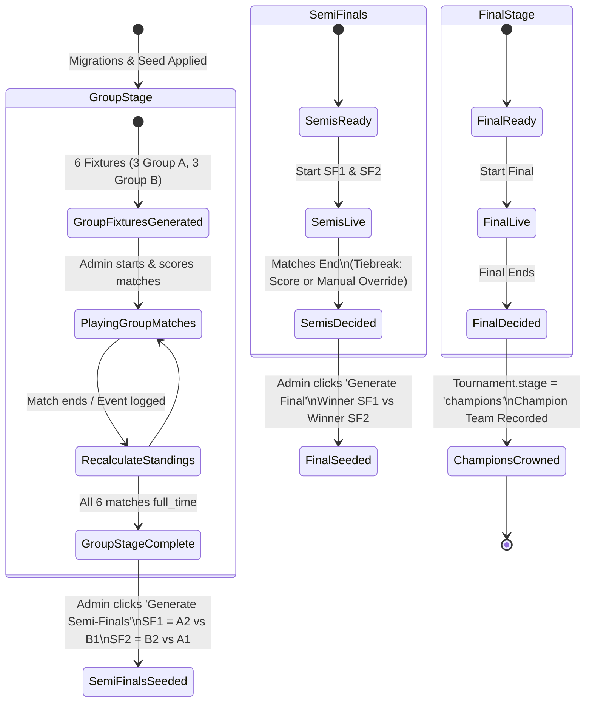
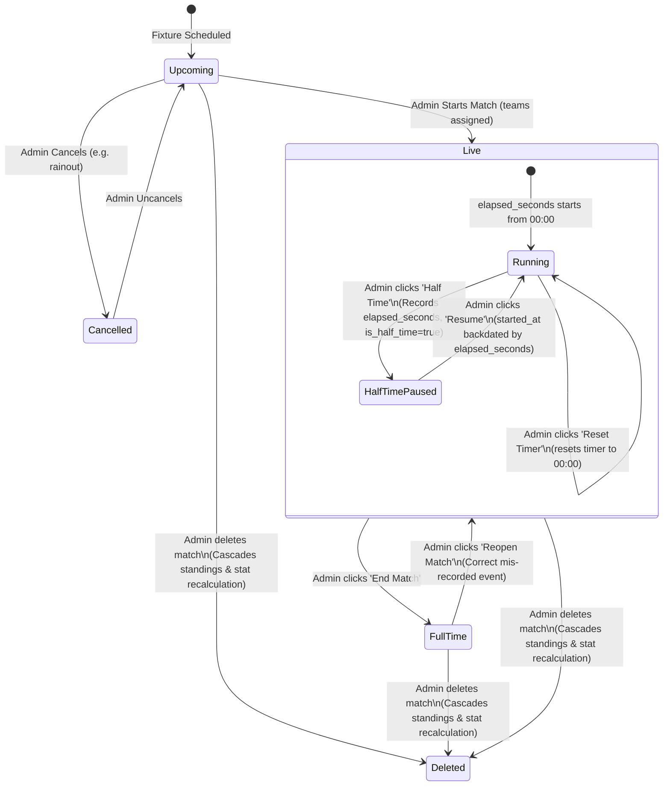

# DCL Season 5 — Digital Scoreboard: Codebase Audit & Architectural Analysis

> **Document Version:** 1.0.0  
> **Target Audience:** Software Engineers, DevOps Engineers, and System Architects onboarding to the project.  
> **Repository:** `Stadia-India/DCL_score_board`  
> **Status:** Production-Ready (Single-instance deployment)

---

## Table of Contents
1. [Executive Summary & Purpose](#1-executive-summary--purpose)
2. [Tech Stack & Dependencies](#2-tech-stack--dependencies)
3. [Project Structure & Organization](#3-project-structure--organization)
4. [System Architecture & Data Flow](#4-system-architecture--data-flow)
5. [End-to-End Workflows & Core Features](#5-end-to-end-workflows--core-features)
6. [Configuration, Build & Deployment](#6-configuration-build--deployment)
7. [Code Quality, Technical Debt & Key Observations](#7-code-quality-technical-debt--key-observations)
8. [Developer Onboarding & Runbook](#8-developer-onboarding--runbook)

---

## 1. Executive Summary & Purpose

### 1.1 Overview & Problem Domain
The **DCL Season 5 Digital Scoreboard** is a full-stack tournament management system and live match centre custom-built for a six-team football tournament (**DCL Season 5**). The core problem domain is the elimination of fragile spreadsheet tracking, manual tiebreak calculations, and uncoordinated score reporting during a live physical tournament.

The tournament format comprises:
- **6 Teams** divided into **2 Groups** of 3 teams (Group A and Group B).
- **6 Group-stage Matches** (round-robin within each group: 3 matches per group).
- **2 Semi-finals** (SF1: Group A 2nd vs Group B 1st; SF2: Group B 2nd vs Group A 1st).
- **1 Final** (Winner SF1 vs Winner SF2) to determine the tournament champion.
- Support for **Extra/Friendly Matches** that do not alter tournament standings, bracket progression, or official tournament player statistics.

### 1.2 Target User Groups
1. **Public Spectators / Fans:**
   - Real-time live scoreboard with animated status indicators.
   - Live match clock synchronized with server-side half-time pauses and resumes.
   - Comprehensive match detail pages with event timelines (goals, assists, cards, Player of the Match awards) and match lineups.
   - Live group standings tables with standard football tiebreaks (Points $\to$ Goal Difference $\to$ Goals For $\to$ Team Name).
   - Tournament statistics and leaderboards (Top Scorers, Top Assists/Playmakers, Discipline, Player of the Match awards).
   - Team profile pages and player cards.
2. **Tournament Administrator / Match Operator:**
   - Single-admin authenticated portal (`/admin`).
   - Match lifecycle controls: scheduling, team assignments, match creation/deletion/renumbering, and cancellation.
   - **Live Control Console (`/admin/matches/:id/live`):** real-time match timer controls (Start, Pause Half-Time, Resume, Reset Timer, End Match, Reopen Match) and instant event logging (Goals with optional assist attribution and minute, Yellow/Red cards, POTM selection).
   - Lineup management to track actual player match appearances.
   - Manual tiebreaker overrides (penalty shootout winner overrides for knockout draws).
   - Team and player squad management (rosters, jersey numbers, managers).
   - Automated bracket progression (Group Fixtures generation, Semi-Final seeding, and Final seeding).

---

## 2. Tech Stack & Dependencies

### 2.1 Backend Stack
- **Language / Runtime:** Python 3.14 (pinned in `backend/Dockerfile` and tested on Python 3.14).
- **Web Framework:** [FastAPI](file:///home/rajesh/Placement_Project/DCL_score_board/backend/requirements.txt#L1) `v0.141.1` (async ASGI framework).
- **ASGI Server:** [Uvicorn](file:///home/rajesh/Placement_Project/DCL_score_board/backend/requirements.txt#L2) `v0.54.0` (standard package with `uvloop`, `websockets`, `httptools`).
- **Database ODM / Driver:** [Beanie ODM](file:///home/rajesh/Placement_Project/DCL_score_board/backend/requirements.txt#L3) `v2.0.0` over [Motor](file:///home/rajesh/Placement_Project/DCL_score_board/backend/requirements.txt#L4) `v3.7.1` (async MongoDB driver).
- **Driver Configuration:** Initialized with `tz_aware=True` in [backend/app/core/database.py](file:///home/rajesh/Placement_Project/DCL_score_board/backend/app/core/database.py#L26) to prevent UTC vs naive datetime arithmetic bugs across timestamps.
- **Validation & Settings:** [Pydantic](file:///home/rajesh/Placement_Project/DCL_score_board/backend/requirements.txt#L5) `v2.13.5` and [pydantic-settings](file:///home/rajesh/Placement_Project/DCL_score_board/backend/requirements.txt#L6) `v2.15.0`.
- **Authentication & Security:** [PyJWT](file:///home/rajesh/Placement_Project/DCL_score_board/backend/requirements.txt#L7) `v2.15.1` (HMAC-SHA256 JWT tokens), [bcrypt](file:///home/rajesh/Placement_Project/DCL_score_board/backend/requirements.txt#L8) `v5.0.0` (salted password hashing).
- **Testing Tools:** [pytest](file:///home/rajesh/Placement_Project/DCL_score_board/backend/requirements-dev.txt#L2) `v9.1.1`, [pytest-asyncio](file:///home/rajesh/Placement_Project/DCL_score_board/backend/requirements-dev.txt#L3) `v1.4.0`, [httpx](file:///home/rajesh/Placement_Project/DCL_score_board/backend/requirements-dev.txt#L4) `v0.28.1`.

### 2.2 Frontend Stack
- **Runtime:** Node.js 20 LTS.
- **Build Tool & Bundler:** [Vite](file:///home/rajesh/Placement_Project/DCL_score_board/frontend/package.json#L26) `v6.0.1` (`@vitejs/plugin-react` `v4.3.4`).
- **UI Framework:** [React](file:///home/rajesh/Placement_Project/DCL_score_board/frontend/package.json#L14) `v18.3.1` & `react-dom` `v18.3.1`.
- **Routing:** [React Router DOM](file:///home/rajesh/Placement_Project/DCL_score_board/frontend/package.json#L16) `v7.18.4` (client-side SPA routing).
- **Icons:** [lucide-react](file:///home/rajesh/Placement_Project/DCL_score_board/frontend/package.json#L13) `v1.16.0`.
- **Styling:** Vanilla CSS design system ([frontend/src/index.css](file:///home/rajesh/Placement_Project/DCL_score_board/frontend/src/index.css)) utilizing CSS variables, responsive typography (`Oswald` for displays, `Manrope` for body), flexbox/grid layouts, and dark theme aesthetics.
- **Testing Tools:** [Vitest](file:///home/rajesh/Placement_Project/DCL_score_board/frontend/package.json#L27) `v4.1.11`, [JSDOM](file:///home/rajesh/Placement_Project/DCL_score_board/frontend/package.json#L25) `v25.0.1`, `@testing-library/react` `v16.1.0`, `@testing-library/jest-dom` `v6.6.3`.

### 2.3 Database & Storage
- **Primary Database:** MongoDB 7.0 (`mongo:7` container or DigitalOcean Managed MongoDB).
- **Schema Management:** Custom forward migration runner ([backend/app/migrations/runner.py](file:///home/rajesh/Placement_Project/DCL_score_board/backend/app/migrations/runner.py)) storing execution state in the `schema_migrations` collection.
- **Media Storage:** Static file distribution from `frontend/public/assets/` (`teams/*.png`, `players/*.jpg`).

### 2.4 Infrastructure & Networking
- **Reverse Proxy:** Nginx 1.27 Alpine ([proxy/nginx.conf.template](file:///home/rajesh/Placement_Project/DCL_score_board/proxy/nginx.conf.template)) terminating TLS, proxying HTTP `/api/` and WebSocket `/ws/`, enforcing Content Security Policy (CSP), HTTP Strict Transport Security (HSTS), and HTTP/2.
- **Container Orchestration:** Docker Compose ([docker-compose.yml](file:///home/rajesh/Placement_Project/DCL_score_board/docker-compose.yml)) and DigitalOcean App Platform spec ([.do/app.yaml](file:///home/rajesh/Placement_Project/DCL_score_board/.do/app.yaml)).
- **Monorepo Dev Scripting:** [concurrently](file:///home/rajesh/Placement_Project/DCL_score_board/package.json#L18) `v9.2.5` in root `package.json`.

---

## 3. Project Structure & Organization

```
DCL_score_board/
├── .do/
│   └── app.yaml                    # DigitalOcean App Platform deployment specification
├── backend/
│   ├── app/
│   │   ├── core/                   # Cross-cutting infrastructure & security
│   │   │   ├── bootstrap.py        # Startup locking, migration execution, and data seeding
│   │   │   ├── config.py           # Pydantic Settings management (.env ingestion)
│   │   │   ├── database.py         # Motor client initialization with tz_aware=True & Beanie binding
│   │   │   ├── deps.py             # FastAPI dependency injection (admin bearer token validation)
│   │   │   ├── errors.py           # Custom exception hierarchy & global error handlers
│   │   │   ├── logging.py          # Request logging & formatters
│   │   │   ├── production_safety.py# Fail-fast security assertions against dev secrets
│   │   │   ├── rate_limit.py       # IP-based exponential backoff rate limiter
│   │   │   ├── security.py         # Bcrypt password hashing & PyJWT token utilities
│   │   │   └── websocket.py        # In-memory WebSocket connection registry & broadcaster
│   │   ├── migrations/             # Sequential MongoDB migrations
│   │   │   ├── m0001_initial_indexes.py
│   │   │   ├── m0002_tournament_and_groups.py
│   │   │   ├── m0003_bootstrap_admin.py
│   │   │   ├── m0004_knockout_match_slots.py
│   │   │   └── runner.py           # CLI & programmatic migration runner
│   │   ├── models/                 # Beanie Document entities (MongoDB collections)
│   │   │   ├── admin.py            # Admin credentials
│   │   │   ├── group.py            # Tournament groups (A & B)
│   │   │   ├── group_team.py       # Group-to-Team mapping join model
│   │   │   ├── match.py            # Match entities & scheduling metadata
│   │   │   ├── match_event.py      # Goals, cards, and POTM events
│   │   │   ├── match_lineup.py     # Per-match player appearance lineups
│   │   │   ├── player.py           # Player profiles & jersey numbers
│   │   │   ├── player_statistics.py# Write-through cached tournament player statistics
│   │   │   ├── team.py             # Team definitions, colors, and crest URLs
│   │   │   ├── tournament.py       # Singleton tournament root entity
│   │   │   └── tournament_standing.py # Write-through cached group standings
│   │   ├── routers/                # FastAPI HTTP & WebSocket route controllers
│   │   │   ├── auth.py             # Admin login & session verification
│   │   │   ├── groups.py           # Group queries & random draw actions
│   │   │   ├── health.py           # /health and /health/db monitoring probes
│   │   │   ├── matches.py          # Match management, live controls, events, and lineups
│   │   │   ├── players.py          # Player CRUD & player profile details
│   │   │   ├── standings.py        # Group standings tables
│   │   │   ├── statistics.py       # Leaderboard aggregations
│   │   │   ├── teams.py            # Team CRUD & group assignments
│   │   │   ├── tournament.py       # Tournament settings & stage status
│   │   │   └── websocket.py        # /ws/live real-time update push endpoint
│   │   ├── schemas/                # Pydantic DTOs for request/response serialization
│   │   ├── scripts/                # Administrative maintenance scripts
│   │   │   ├── import_match_schedule.py  # Ingests match_schedule.json
│   │   │   ├── import_tournament_data.py  # Ingests tournament_data.json
│   │   │   ├── reset_matches.py    # Resets matches to upcoming state
│   │   │   ├── seed_data.py        # Seeds initial development dummy data
│   │   │   └── set_admin_password.py # CLI admin password reset tool
│   │   ├── services/               # Core business logic & database mutations
│   │   │   ├── auth.py             # Admin authentication logic
│   │   │   ├── groups.py           # Group shuffling & team assignments
│   │   │   ├── lineups.py          # Lineup updates & appearance tracking
│   │   │   ├── match_events.py     # Event creation, validation, and deletion
│   │   │   ├── matches.py          # Match lifecycle, scoring, timing, bracket generation
│   │   │   ├── player_stats.py     # Player statistics recalculation engine
│   │   │   ├── players.py          # Player CRUD & detail aggregations
│   │   │   ├── serializers.py      # DTO transformation mappers
│   │   │   ├── standings.py        # Group standings recomputation engine
│   │   │   ├── statistics.py       # Leaderboard builders
│   │   │   ├── teams.py            # Team operations & conflict checks
│   │   │   ├── tournament_scope.py # Active tournament resolution
│   │   │   └── tournament_stage.py # Bracket stage transitions & winner resolution
│   │   └── main.py                 # FastAPI application factory, middleware, lifespan
│   ├── data/                       # Bundled tournament JSON data files & templates
│   ├── tests/                      # Pytest test suite (248 tests)
│   ├── Dockerfile                  # Python 3.14 slim multi-stage container
│   ├── docker-entrypoint.sh        # Startup script handling migrations & uvicorn
│   └── requirements.txt            # Pinned production Python dependencies
├── database/
│   └── mongo/                      # MongoDB initialization hooks
├── frontend/
│   ├── public/                     # Static assets (team logos, favicon)
│   ├── src/
│   │   ├── api/                    # API wrapper clients (client.js, matches.js, etc.)
│   │   ├── components/             # Reusable UI components (common, match, nav, standings, stats)
│   │   ├── context/                # React context providers (WebSocketContext.jsx)
│   │   ├── hooks/                  # Custom React hooks (useLiveSocket.js)
│   │   ├── pages/                  # Top-level view pages (Home, Matches, Standings, Stats, etc.)
│   │   │   └── admin/              # Admin pages (Login, Dashboard, Live Control)
│   │   ├── routes/                 # React Router definition (AppRouter.jsx)
│   │   ├── utils/                  # Formatting & time helper functions
│   │   ├── App.jsx                 # Root component with layout, header, footer
│   │   ├── index.css               # Vanilla CSS design system
│   │   └── main.jsx                # DOM mounting entrypoint
│   ├── Dockerfile                  # Node build + Nginx static serve container
│   ├── nginx.conf                  # Frontend static file server & SPA fallback config
│   ├── package.json                # Frontend dependencies and scripts
│   └── vite.config.js              # Vite configuration with proxy rules
├── proxy/
│   ├── Dockerfile                  # Reverse proxy Nginx container
│   ├── generate-dev-cert.sh        # Self-signed TLS certificate generator for local testing
│   └── nginx.conf.template         # Master reverse proxy template with TLS & WebSocket support
├── AUDIT.md                        # Authoritative test and production-readiness audit record
├── DEPLOYMENT.md                   # DigitalOcean App Platform deployment documentation
├── docker-compose.yml              # Local multi-container development & production testing
├── package.json                    # Root script runner for concurrent dev & testing
└── README.md                       # High-level repository documentation
```

### 3.1 Architectural Conventions & Design Patterns
- **Layered Clean Architecture (Backend):** Clear separation between transport/routing ([backend/app/routers/](file:///home/rajesh/Placement_Project/DCL_score_board/backend/app/routers)), domain business logic ([backend/app/services/](file:///home/rajesh/Placement_Project/DCL_score_board/backend/app/services)), data models ([backend/app/models/](file:///home/rajesh/Placement_Project/DCL_score_board/backend/app/models)), and serialization transfer schemas ([backend/app/schemas/](file:///home/rajesh/Placement_Project/DCL_score_board/backend/app/schemas)).
- **Materialized Write-Through Caches:** Standings ([TournamentStanding](file:///home/rajesh/Placement_Project/DCL_score_board/backend/app/models/tournament_standing.py#L8)) and player statistics ([PlayerStatistics](file:///home/rajesh/Placement_Project/DCL_score_board/backend/app/models/player_statistics.py#L8)) are calculated and stored during mutations rather than aggregated on every public read request.
- **Fail-Fast Defense-in-Depth:** Config assertion during startup ([backend/app/core/production_safety.py](file:///home/rajesh/Placement_Project/DCL_score_board/backend/app/core/production_safety.py)) ensures the app aborts launch in `ENVIRONMENT=production` if default passwords, placeholder secrets, or `localhost` CORS origins are configured.
- **Distributed Startup Locking:** Mongo atomic collection insertion (`startup_locks`) in [backend/app/core/bootstrap.py](file:///home/rajesh/Placement_Project/DCL_score_board/backend/app/core/bootstrap.py#L38) prevents race conditions during multi-instance rolling deploys.
- **Cache-Invalidation WebSockets:** The WebSocket layer sends lightweight push notification signals (e.g. `{"type": "match_status_changed", "match_id": "..."}`) that trigger targeted re-fetching on the frontend rather than streaming large state deltas.

---

## 4. System Architecture & Data Flow

### 4.1 High-Level Architecture Diagram

```mermaid
flowchart TD
    subgraph Clients["Clients"]
        BrowserSpectator["Public Spectators\n(Desktop & Mobile Web)"]
        BrowserAdmin["Tournament Admin\n(/admin & Live Control)"]
    end

    subgraph EdgeProxy["Edge Reverse Proxy (Nginx / DigitalOcean Edge)"]
        Proxy["Nginx Reverse Proxy\n(TLS Termination, Port 443/80)\nSecurity Headers & CSP"]
    end

    subgraph Containers["Application Layer"]
        FrontendNginx["Frontend Container\n(Nginx 1.27 Alpine)\nServes Built SPA Dist"]
        
        subgraph BackendApp["FastAPI Backend (Port 8000)"]
            Router["FastAPI Routers\n(/api & /ws)"]
            AuthMiddleware["Auth & Rate Limiting\n(PyJWT, Bcrypt, Proxy-Aware IP Throttle)"]
            ServiceLayer["Service Layer\n(matches, standings, player_stats, lineups)"]
            WSHub["In-Process WebSocket Hub\n(ConnectionManager)"]
        end
    end

    subgraph DatabaseLayer["Data Persistence (MongoDB 7.0)"]
        Mongo[("MongoDB Database\ndcl_scoreboard")]
        subgraph Collections["Collections"]
            ColTournaments["tournaments"]
            ColTeams["teams / groups / group_teams"]
            ColPlayers["players"]
            ColMatches["matches"]
            ColEvents["match_events"]
            ColLineups["match_lineups"]
            ColStandings["tournament_standings (Materialized)"]
            ColStats["player_statistics (Materialized)"]
            ColAdmin["admins"]
            ColLocks["startup_locks / startup_state"]
        end
    end

    BrowserSpectator -->|HTTPS GET Static Assets| Proxy
    BrowserAdmin -->|HTTPS POST/PUT/PATCH/DELETE| Proxy
    BrowserSpectator -->|WSS /ws/live| Proxy
    BrowserAdmin -->|WSS /ws/live| Proxy

    Proxy -->|Route /| FrontendNginx
    Proxy -->|Route /api/*| Router
    Proxy -->|Route /ws/*| Router

    Router --> AuthMiddleware
    AuthMiddleware --> ServiceLayer
    ServiceLayer -->|Beanie / Motor async| Mongo
    ServiceLayer -->|Trigger broadcast()| WSHub
    WSHub -.->|Push JSON Invalidation| BrowserSpectator
    WSHub -.->|Push JSON Invalidation| BrowserAdmin
```

### 4.2 Data Flow Walkthroughs

#### Flow 1: Public Read Flow (e.g. Standings or Matches Page)
1. User requests `/standings` in the browser.
2. The browser loads cached React SPA bundle via the reverse proxy.
3. React executes `useEffect()` to call `standingsApi.getStandings()`.
4. Browser issues `GET /api/standings` to Nginx proxy.
5. Proxy forwards request to FastAPI backend (`backend:8000`).
6. FastAPI matches route in [backend/app/routers/standings.py](file:///home/rajesh/Placement_Project/DCL_score_board/backend/app/routers/standings.py).
7. Service reads pre-materialized [TournamentStanding](file:///home/rajesh/Placement_Project/DCL_score_board/backend/app/models/tournament_standing.py#L8) documents from MongoDB sorted by `points DESC, goal_difference DESC, goals_for DESC, name ASC`.
8. Serialized JSON payload is returned with security headers (`X-Content-Type-Options: nosniff`, etc.).

#### Flow 2: Live Scoring Mutation Flow (Admin logs a Goal)
1. Operator on `/admin/matches/:id/live` selects scorer, optional assist, minute, and submits "Add Goal".
2. Client sends `POST /api/matches/:id/events` with `Authorization: Bearer <token>` and payload:
   ```json
   { "type": "goal", "team_id": "...", "player_id": "...", "assist_player_id": "...", "minute": 24 }
   ```
3. FastAPI dependency [get_current_admin](file:///home/rajesh/Placement_Project/DCL_score_board/backend/app/core/deps.py#L12) verifies the JWT bearer token against `JWT_SECRET`.
4. Controller calls [app.services.match_events.add_event()](file:///home/rajesh/Placement_Project/DCL_score_board/backend/app/services/match_events.py#L15).
5. The `MatchEvent` is validated (e.g., minute $\le$ 120, player belongs to assigned team) and inserted into MongoDB.
6. The service triggers:
   - [recalculate_player_statistics()](file:///home/rajesh/Placement_Project/DCL_score_board/backend/app/services/player_stats.py#L14) for both the goal scorer and assist provider.
   - If the match is a group match, [recalculate_group_standings()](file:///home/rajesh/Placement_Project/DCL_score_board/backend/app/services/standings.py#L16) is invoked if the match is marked completed or reopened.
7. [broadcast({"type": "match_event_added", "match_id": "..."})](file:///home/rajesh/Placement_Project/DCL_score_board/backend/app/core/websocket.py#L66) is called.
8. The in-memory WebSocket manager iterates over all connected client sockets and pushes the notification JSON frame.
9. Connected spectator and admin browser clients receive the message and trigger non-blocking UI background refreshes.

### 4.3 Authentication, Authorization & Security Architecture
- **Single-Admin Design:** The system intentionally operates with exactly one admin account seeded via migration `m0003_bootstrap_admin` or environment variable `ADMIN_BOOTSTRAP_PASSWORD`.
- **Session Tokens:** Stateless JWT tokens signed with HMAC-SHA256 containing admin user ID `sub` and expiration timestamp (default: 12 hours / 720 minutes).
- **Brute-Force & Denial-of-Service Defense:**
  - Login attempts are throttled by client IP using [LoginRateLimiter](file:///home/rajesh/Placement_Project/DCL_score_board/backend/app/core/rate_limit.py#L20).
  - The first **5 failed attempts** are free (to avoid locking out an operator for an accidental typo).
  - Subsequent failures trigger exponential backoff: $1s, 2s, 4s, \dots$ up to a maximum cap of $60s$ delay per IP.
  - **Account lockout is explicitly avoided:** Locking the single tournament admin account would create a severe Denial-of-Service vulnerability during a live sporting event.
  - **Proxy-Aware IP Resolution:** In [backend/app/routers/auth.py](file:///home/rajesh/Placement_Project/DCL_score_board/backend/app/routers/auth.py#L15), the client IP is extracted using `TRUSTED_PROXY_HOPS` (default: 1). It takes the entry appended by the trusted reverse proxy ($N$-th from the right) rather than trusting spoofable leftmost headers.

---

## 5. End-to-End Workflows & Core Features

### 5.1 Tournament Lifecycle & Progression Engine



### 5.2 Match Lifecycle & Timer Architecture



- **Timer Calculation Formula:**
  - When `is_half_time = False` and status is `live`:  
    $$\text{Elapsed Seconds} = \max(0, \text{now}_{\text{UTC}} - \text{started\_at}_{\text{UTC}})$$
  - When `is_half_time = True`:  
    $$\text{Elapsed Seconds} = \text{elapsed\_seconds (frozen)}$$
  - When resumed:  
    $$\text{started\_at} \leftarrow \text{now}_{\text{UTC}} - \text{elapsed\_seconds}$$

### 5.3 Complete API Endpoint Matrix

| Method | Endpoint | Access | Description |
|---|---|---|---|
| `GET` | `/health` | Public | Basic service liveness health check probe. |
| `GET` | `/health/db` | Public | Database readiness probe; reports document counts for all 11 collections. |
| `GET` | `/ws/live` | Public | WebSocket endpoint for client connections and invalidation broadcasts. |
| `POST` | `/api/auth/login` | Public | Authenticates admin credentials; throttled by client IP with exponential backoff. |
| `GET` | `/api/auth/me` | Admin | Returns current authenticated admin identity. |
| `GET` | `/api/tournament` | Public | Returns singleton tournament status, stage, and champion. |
| `PATCH` | `/api/tournament` | Admin | Updates tournament metadata and formatting descriptions. |
| `GET` | `/api/teams` | Public | Returns list of teams, their assigned groups, and roster counts. |
| `POST` | `/api/teams` | Admin | Creates a new team (unique name and valid hex color required). |
| `GET` | `/api/teams/{id}` | Public | Retrieves specific team details. |
| `PATCH` | `/api/teams/{id}` | Admin | Updates team name, color, crest URL, or group assignment. |
| `DELETE` | `/api/teams/{id}` | Admin | Deletes a team (blocked if team has players or matches). |
| `GET` | `/api/groups` | Public | Lists Groups A & B with assigned member teams. |
| `POST` | `/api/groups/random-draw` | Admin | Randomly draws and assigns 3 teams to Group A and 3 to Group B. |
| `GET` | `/api/players` | Public | Lists players, optionally filtered by `?team_id=`. |
| `GET` | `/api/players/{id}` | Public | Detailed player profile with tournament stats, match history, and events. |
| `POST` | `/api/players` | Admin | Adds a player to a team (auto-assigns DCL ID; unique jersey number enforced). |
| `PATCH` | `/api/players/{id}` | Admin | Modifies player fields (setting `is_manager=true` unsets previous manager). |
| `DELETE` | `/api/players/{id}` | Admin | Deletes a player (blocked if player has recorded match events or lineups). |
| `GET` | `/api/matches` | Public | Lists matches with filtering (`team_id`, `stage`, `group_id`, `status`, `date`). |
| `GET` | `/api/matches/upcoming` | Public | Shortcut filter for scheduled/upcoming matches. |
| `GET` | `/api/matches/live` | Public | Shortcut filter for in-progress matches. |
| `GET` | `/api/matches/completed` | Public | Shortcut filter for finished matches. |
| `GET` | `/api/matches/{id}` | Public | Detailed match information including chronological events and lineup. |
| `POST` | `/api/matches` | Admin | Creates a new match (group fixture or extra friendly match). |
| `PATCH` | `/api/matches/{id}` | Admin | Updates match schedule (date, time, venue, notes, match number). |
| `DELETE` | `/api/matches/{id}` | Admin | Permanently deletes a match and cascades stat/standing recalculations. |
| `PUT` | `/api/matches/{id}/teams` | Admin | Assigns or replaces team pairings for an upcoming match. |
| `POST` | `/api/matches/{id}/start` | Admin | Transitions match from `upcoming` to `live` (initializes timer). |
| `POST` | `/api/matches/{id}/end` | Admin | Transitions match from `live` to `full_time` (recalculates standings & stage). |
| `POST` | `/api/matches/{id}/reopen` | Admin | Transitions match from `full_time` to `live` for event correction. |
| `POST` | `/api/matches/{id}/half-time` | Admin | Pauses match timer at half-time and freezes elapsed duration. |
| `POST` | `/api/matches/{id}/resume` | Admin | Resumes match timer from half-time. |
| `POST` | `/api/matches/{id}/reset-timer`| Admin | Resets live match timer to 00:00. |
| `POST` | `/api/matches/{id}/cancel` | Admin | Cancels an upcoming match. |
| `POST` | `/api/matches/{id}/uncancel` | Admin | Reverts a cancelled match to upcoming. |
| `POST` | `/api/matches/{id}/winner` | Admin | Sets manual winner override for a drawn knockout match. |
| `POST` | `/api/matches/generate-group-fixtures` | Admin | (Re)generates the 3 round-robin matches for a group. |
| `POST` | `/api/matches/generate-semis` | Admin | Seeds the 2 semi-final slots based on group standings. |
| `POST` | `/api/matches/generate-final` | Admin | Seeds the final match slot with semi-final winners. |
| `GET` | `/api/matches/{id}/events` | Public | Lists match events ordered chronologically by minute. |
| `POST` | `/api/matches/{id}/events` | Admin | Adds a match event (`goal`, `yellow`, `red`, `potm`). |
| `DELETE` | `/api/matches/{id}/events/{id}` | Admin | Deletes an event and rolls back statistics. |
| `GET` | `/api/matches/{id}/lineup` | Public | Retrieves active lineup of participating players for a match. |
| `PUT` | `/api/matches/{id}/lineup` | Admin | Sets match lineup (used to derive official player appearances). |
| `GET` | `/api/standings` | Public | Returns standings tables for both Group A and Group B. |
| `GET` | `/api/standings/{group_id}` | Public | Returns standings table for a single group. |
| `GET` | `/api/statistics/leaderboards` | Public | Returns Top Scorers, Playmakers, Discipline, and POTM rankings. |

---

## 6. Configuration, Build & Deployment

### 6.1 Environment Variables Reference

| Variable Name | Component | Scope / Required | Default Value | Description / Validation Constraints |
|---|---|---|---|---|
| `ENVIRONMENT` | Backend | Required | `development` | Set to `production` in live environments. Triggers fail-fast checks. |
| `DEBUG` | Backend | Optional | `true` | Enables verbose debug logging and FastAPI `/docs` (disabled in prod). |
| `MONGO_URI` | Backend / DB | Required | `mongodb://localhost:27017` | MongoDB connection URI with authentication credentials. |
| `MONGO_DB_NAME` | Backend | Optional | `dcl_scoreboard` | Primary database name. |
| `JWT_SECRET` | Backend | Required (Secret) | `change-me-in-.env` | Secret key for signing admin tokens. Refuses to boot if $<32$ chars in prod. |
| `JWT_ALGORITHM` | Backend | Optional | `HS256` | Token signing algorithm. |
| `JWT_EXPIRES_MINUTES` | Backend | Optional | `720` | Token expiration time in minutes (12 hours). |
| `ADMIN_BOOTSTRAP_USERNAME` | Backend | Optional | `admin` | Initial admin username created during migration `m0003`. |
| `ADMIN_BOOTSTRAP_PASSWORD` | Backend | Required (Secret) | `change-me-in-.env` | Initial admin password. Refuses known dev passwords in prod. |
| `TRUSTED_PROXY_HOPS` | Backend | Optional | `1` | Number of upstream reverse proxies appending to `X-Forwarded-For`. |
| `CORS_ORIGINS` | Backend | Required | `http://localhost:5173` | Comma-separated allowed frontend origins. Refuses `localhost` in prod. |
| `AUTO_MIGRATE` | Backend | Optional | `true` | Automatically executes pending schema migrations on startup. |
| `AUTO_SEED` | Backend | Optional | `true` | Idempotently seeds initial tournament data on first launch. |
| `TOURNAMENT_NAME` | Backend | Optional | `DCL Season 5` | Tournament display name. |
| `TOURNAMENT_SEASON` | Backend | Optional | `5` | Tournament season identifier. |
| `MONGO_INITDB_ROOT_USERNAME` | Docker Compose | Optional | `dcl_admin` | Root Mongo user in Docker Compose. |
| `MONGO_INITDB_ROOT_PASSWORD` | Docker Compose | Optional | `change-me-strong-password` | Root Mongo password in Docker Compose. |
| `HTTP_PORT` | Compose / Proxy | Optional | `8090` (80 in prod) | Host port for HTTP proxy redirector. |
| `HTTPS_PORT` | Compose / Proxy | Optional | `8443` (443 in prod) | Host port for HTTPS reverse proxy. |
| `VITE_API_TARGET` | Frontend | Optional (Dev) | `http://127.0.0.1:8001` | Dev proxy target for Vite dev server. |
| `VITE_PORT` | Frontend | Optional (Dev) | `5173` | Local Vite dev server port. |

### 6.2 Local Development Workflows

#### Option A: Native Dev (Recommended for Rapid Hot-Reloading)
1. **Start MongoDB:**
   ```bash
   docker compose up -d mongo
   ```
2. **Setup Backend:**
   ```bash
   cd backend
   python3.14 -m venv venv
   ./venv/bin/pip install -r requirements-dev.txt
   cp .env.example .env
   # Run migrations and seed data:
   ./venv/bin/python -m app.migrations.runner
   ./venv/bin/python -m app.scripts.seed_data
   # Run Uvicorn server:
   ./venv/bin/uvicorn app.main:app --reload --port 8001
   ```
3. **Setup Frontend:**
   ```bash
   cd frontend
   npm install
   npm run dev
   ```
   Open `http://localhost:5173`.
4. **Root Shortcut:**
   From root directory: `npm run dev` (starts backend and frontend concurrently).

#### Option B: Full Containerized Stack (Closest to Production)
```bash
cp .env.example .env
cp backend/.env.example backend/.env
./proxy/generate-dev-cert.sh
docker compose up -d
```
Access the application at `https://localhost:8443` (accepting self-signed cert).

### 6.3 Automated Testing Suites

#### Backend Test Suite (Pytest)
Backend tests run against an isolated throwaway database (`dcl_scoreboard_test`) on MongoDB to protect development and production records:
```bash
cd backend
./venv/bin/pytest -v
```
*Current test count: 248 passed tests covering authentication boundaries, fixture generation, lifecycle transitions, rate limiting, and performance batching.*

#### Frontend Test Suite (Vitest)
Runs unit and component tests with mock API bindings:
```bash
cd frontend
npm test
```
*Current test count: 34 passed tests covering live controls, admin guards, and rendering states.*

#### Monorepo Combined Test
```bash
npm test
```

### 6.4 Production Deployment: DigitalOcean App Platform
The application is pre-configured for DigitalOcean App Platform via [.do/app.yaml](file:///home/rajesh/Placement_Project/DCL_score_board/.do/app.yaml):
- **Pre-Deploy Job:** Automatically executes `python -m app.migrations.runner` in a temporary container before new backend instances receive live traffic.
- **Backend Service:** Runs `docker-entrypoint.sh` executing Uvicorn with 1 worker behind the platform proxy on port 8000.
- **Frontend Service:** Runs multi-stage Nginx container serving compiled static assets on port 80.
- **Auto-Deploy:** Linked to `Stadia-India/DCL_score_board` on push to `main`.

---

## 7. Code Quality, Technical Debt & Key Observations

### 7.1 Architecture Strengths
1. **Defensive Production Booting:**
   [app/core/production_safety.py](file:///home/rajesh/Placement_Project/DCL_score_board/backend/app/core/production_safety.py) rigorously protects the deployment. If `ENVIRONMENT=production` is set with dev passwords (`replace-with-a-strong-password`, `dcl-dev-admin-password`), insecure JWT secrets ($<32$ characters), or dev CORS origins, the service intentionally refuses to start.
2. **Atomic Bootstrap Locking:**
   [app/core/bootstrap.py](file:///home/rajesh/Placement_Project/DCL_score_board/backend/app/core/bootstrap.py) uses an atomic MongoDB lock in `startup_locks` with TTL expiration. This ensures rolling deployments do not create race conditions or duplicate inserts.
3. **Optimized Batch Querying:**
   In [app/services/matches.py](file:///home/rajesh/Placement_Project/DCL_score_board/backend/app/services/matches.py#L26), `compute_scores_and_winners()` uses a single batched MongoDB `$in` query across goal events rather than issuing $2N$ queries per match listing. Similarly, `recalculate_group_standings()` batches all goal events across the group in one round-trip.
4. **Timezone Awareness (`tz_aware=True`):**
   Initializing Motor with `tz_aware=True` guarantees that BSON UTC timestamps parsed into Python `datetime` objects maintain their timezone marker, preventing subtraction errors between naive and aware datetimes.
5. **NoSQL Injection & Input Sanitization:**
   Pydantic strict schema typing combined with Beanie parameterization prevents NoSQL operator injection attacks (e.g. `{"$gt": ""}`).

### 7.2 Known Constraints & Technical Debt
1. **Single Backend Instance Constraint:**
   The WebSocket connection registry ([ConnectionManager](file:///home/rajesh/Placement_Project/DCL_score_board/backend/app/core/websocket.py#L10)) and the IP login rate limiter ([LoginRateLimiter](file:///home/rajesh/Placement_Project/DCL_score_board/backend/app/core/rate_limit.py#L20)) are held in Python process memory. The app must run as a **single instance** (`instance_count: 1`).
   > [!NOTE]
   > For horizontal scaling across multiple instances, WebSocket broadcasting would require a Redis Pub/Sub backplane, and rate limiting would need Redis distributed counters.
2. **Duplicate Team Crest Assets:**
   `frontend/public/assets/teams/` contains duplicate files (`1-6.jpeg`, `<team>.jpeg`, and `<team>.png`). Only `<team>.png` is referenced by the UI.
3. **Absence of Player Photos:**
   `frontend/public/assets/players/` does not currently contain headshots. The frontend gracefully falls back to displaying player initials via the `<Avatar />` component.
4. **Mobile Navigation Bar Scrolling:**
   The top navigation bar contains 6 tabs which scroll horizontally on narrow mobile screens (375px width). While functional without layout clipping, a hamburger dropdown would provide an improved mobile UX.

---

## 8. Developer Onboarding & Runbook

### 8.1 First-Day Checklist
- [ ] Install Docker and Docker Compose.
- [ ] Install Python 3.14 (or use pyenv: `pyenv install 3.14.0`).
- [ ] Install Node.js 20 LTS.
- [ ] Clone repository: `git clone https://github.com/Stadia-India/DCL_score_board.git`.
- [ ] Copy `.env.example` to `.env` in repository root and `backend/.env.example` to `backend/.env`.
- [ ] Start database: `docker compose up -d mongo`.
- [ ] Install backend dependencies and run migrations:
  ```bash
  cd backend && python3.14 -m venv venv && ./venv/bin/pip install -r requirements-dev.txt
  ./venv/bin/python -m app.migrations.runner
  ```
- [ ] Run backend tests to verify environment: `./venv/bin/pytest`.
- [ ] Install frontend dependencies and run tests:
  ```bash
  cd ../frontend && npm install && npm test
  ```
- [ ] Start development stack: from repo root, run `npm run dev`.
- [ ] Access API docs at `http://localhost:8001/docs` and frontend at `http://localhost:5173`.

### 8.2 Common Operational Commands

#### How to Reset Tournament Matches (e.g., after test runs)
```bash
cd backend
./venv/bin/python -m app.scripts.reset_matches
```

#### How to Re-import Official Tournament Data & Schedule
```bash
cd backend
./venv/bin/python -m app.scripts.import_tournament_data
./venv/bin/python -m app.scripts.import_match_schedule
```

#### How to Reset Admin Password from CLI
```bash
cd backend
./venv/bin/python -m app.scripts.set_admin_password --username admin --password "NewSecurePassword123!"
```

---
*Report generated autonomously as part of the read-only codebase architectural audit.*
