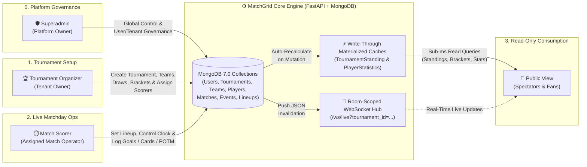

# MatchGrid — Master Project Plan & Architectural Blueprint

**Document Version:** 1.0.0  
**Target Path:** `docs/plan.md`  
**Project Name:** MatchGrid (Evolved from DCL Season 5 Digital Scoreboard)  
**Architecture:** Multi-Tenant, Multi-Tournament Live Football Management & Real-Time Scoreboard Platform  

---

## 1. Project Goal

The primary goal of **MatchGrid** is to transform a single-event, hardcoded 6-team internship application (*DCL Season 5 Digital Scoreboard*) into an **industry-standard, multi-tenant, multi-tournament live football SaaS platform**.

Specifically, this project aims to achieve four core objectives:
1. **Eliminate Single-Tournament & Hardcoded Constraints:** Replace rigid 6-team / 2-group / single-admin logic with a dynamic tournament engine capable of running multiple concurrent tournaments with customizable group sizes, round-robin fixtures, and knockout brackets.
2. **Enforce Strict 4-Tier Role-Based Access Control (RBAC):** Establish clear operational boundaries across **Superadmins** (platform owners), **Tournament Organizers** (tenant owners), **Match Scorers** (matchday operators), and **Public Spectators** (read-only viewers).
3. **Deliver Broadcast-Grade Real-Time Telemetry:** Provide sub-second live score updates, UTC-synchronized match clocks with drift-free half-time pause/resume, and pre-computed materialized standings/leaderboards powered by room-scoped WebSockets.
4. **Build a Flagship Placement & Engineering Portfolio Project:** Demonstrate production-grade full-stack engineering—covering clean monorepo organization, write-through caching, distributed locking, automated unit/integration/E2E testing, and zero-cost cloud deployment.

---

## 2. Overall Idea & Core Concept

### 2.1 Operational Pipeline & Four-Tier Role Hierarchy

MatchGrid operates as a structured operational pipeline where platform governance, tournament setup, live matchday scoring, and public consumption are cleanly decoupled:

```
1. Superadmin (Platform Owner — Us)
   └── Global control over the entire application, all tournaments, users, and system settings
        │
2. Tournament Organizer (Tenant Owner)
   └── Scoped strictly to tournaments they organize (teams, rosters, draws, brackets, scorer assignment)
        │
3. Match Scorer (Matchday Operator)
   └── Scoped strictly to specific matches assigned to them by an Organizer (clock, lineups, live events)
        │
4. Public View (Spectators & Fans)
   └── Unauthenticated, read-only access to the tournament hub, live scoreboards, standings & brackets
```

#### Role Permissions & Isolation Matrix

| Tier / Role | System Identity & Scope | Core Responsibilities | Database & API Enforcement |
| :--- | :--- | :--- | :--- |
| **1. Superadmin**<br>(`SUPER_ADMIN`) | **Platform Owner (Us)**<br>Global access across the entire application | • Full control over all tournaments, organizers, scorers, and platform settings<br>• Approve, suspend, or manage Organizer and Scorer accounts<br>• View, edit, intervene in, or delete any tournament, match, or record<br>• Monitor system health, database metrics, and global audit logs | • Bypasses `organizer_id` and `assigned_scorer_ids` ownership filters<br>• Exclusive access to `/api/superadmin/*` platform governance endpoints |
| **2. Tournament Organizer**<br>(`ORGANIZER`) | **Tenant Owner**<br>Scoped strictly to `tournament.organizer_id == user.id` | • Create and configure their own tournaments (groups, teams, rosters, point rules, knockout format)<br>• Run random group draws, generate fixtures, and seed knockout brackets<br>• Create/manage **Match Scorers** and assign them to specific matches<br>• Act as fallback live scorer for matches within their own tournaments | • Every query and mutation enforces `tournament.organizer_id == current_user.id`<br>• Completely isolated from tournaments belonging to other organizers |
| **3. Match Scorer**<br>(`SCORER`) | **Matchday Operator**<br>Scoped strictly to `user.id in match.assigned_scorer_ids` | • Access the **Live Match Console** exclusively for assigned matches<br>• Configure active match lineups<br>• Control the UTC-synced match clock (Start, Half-Time, Resume, Reset, End/Reopen)<br>• Log real-time events (Goals, Assists, Yellow/Red Cards, Player of the Match) | • Blocked from tournament settings, team/player CRUD, bracket generation, and unassigned matches<br>• Write access restricted to `/matches/:id/live`, `/lineup`, and `/events` for assigned matches |
| **4. Public View**<br>(`PUBLIC`) | **Unauthenticated**<br>Read-only access to public tournaments | • Browse the multi-tournament directory (Live, Upcoming, Completed)<br>• Watch real-time scoreboards and synced live match clocks<br>• View group standings, visual knockout brackets, team squads, and player leaderboards | • `GET`-only endpoints reading from pre-computed materialized caches + room-scoped `/ws/live` |

---

### 2.2 End-to-End System Workflow



---

### 2.3 Core Technical & Visual Pillars

1. **Dynamic Tournament & Bracket Engine:**
   * Supports configurable group counts ($N$ groups of $M$ teams), customizable point systems (Win/Draw/Loss), circle-method round-robin fixture generation, and dynamic knockout bracket seeding (4-team Semi-Finals, 8-team Quarter-Finals, or 16-team Round of 16) with manual penalty-shootout winner overrides.
2. **Write-Through Materialized Views:**
   * Public read traffic never runs expensive on-the-fly aggregations. Every match completion or event mutation updates pre-computed `TournamentStanding` and `PlayerStatistics` documents using batched MongoDB `$in` queries.
3. **Room-Scoped WebSocket Cache Invalidation:**
   * Instead of broadcasting events globally to all users, `/ws/live` scopes connections by `tournament_id`. Spectators watching Tournament A receive lightweight invalidation signals (`match_event_added`, `match_status_changed`) only for Tournament A.
4. **Drift-Free UTC Match Clock (`tz_aware=True`):**
   * All timestamps are stored in timezone-aware UTC. Elapsed match time is computed dynamically as $\max(0, \text{now}_{\text{UTC}} - \text{started\_at}_{\text{UTC}})$, with half-time pause freezing `elapsed_seconds` and resume backdating `started_at`.
5. **MatchGrid Brand Identity & Two-Tier UI:**
   * **Visual Theme:** Deep Stadium Slate (`#0B0F14` canvas, `#131A22` card surface, `#1C2530` elevated panels), Pitch Emerald (`#10B981`), Goalpost White (`#F8FAFC`), Broadcast Crimson (`#EF4444`), and Champion Gold (`#F59E0B`), paired with tabular numerals (`tabular-nums`) for zero-jitter live clocks.
   * **Navigation:** Two-tier responsive layout separating the **Global Tournament Discovery Header** from the **Tournament-Scoped Context Bar** (`/t/:slug/...`) and **Role-Based Dashboards** (`/superadmin`, `/organizer`, `/scorer`).

---

## 3. Entire Project Plan (Phased Roadmap)

### Phase 0: Foundation, Monorepo, Rebranding & Clean Slate *(Completed)*
* [x] Restructure repository into a **Bun workspace monorepo** (`apps/backend`, `apps/frontend`, `e2e`, `docs`).
* [x] Configure **Docker** exclusively for `mongo:7` (`docker-compose.yml`), running FastAPI (`:8001`) and Vite (`:5173`) natively via `bun run dev`.
* [x] Replace all legacy `DCL Season 5` branding and assets with the **MatchGrid** football-and-goalpost logo and Deep Stadium Slate + Pitch Emerald design tokens.
* [x] Wipe all legacy DCL seed records so the database starts clean while preserving schema indexes.
* [x] Configure **Playwright** E2E testing (`playwright.config.ts`, `e2e/`) and codify the 7-stage feature lifecycle workflow.

### Phase 1: Four-Tier RBAC & Multi-Tenant Data Isolation *(Next Up)*
* **Database Layer:**
  * Replace the single `admins` collection with a unified `users` collection supporting roles: `SUPER_ADMIN`, `ORGANIZER`, and `SCORER`.
  * Add `organizer_id` and `slug` (unique, indexed) to `Tournament`.
  * Add `tournament_id` (indexed) across all child collections (`Group`, `GroupTeam`, `Team`, `Player`, `Match`, `MatchEvent`, `MatchLineup`, `TournamentStanding`, `PlayerStatistics`) with compound indexes `(tournament_id, group_id, points)`.
  * Add `assigned_scorer_ids: list[PydanticObjectId]` to `Match` so Organizers can assign one or more Scorers to specific matches.
  * Write forward migration `m0005_multi_tenant_rbac.py` and bootstrap the default `SUPER_ADMIN` account via environment variables.
* **Backend Layer:**
  * Implement FastAPI dependency guards in `app/core/deps.py`:
    * `require_superadmin`: Restricts access to `SUPER_ADMIN`.
    * `require_tournament_owner(tournament_id)`: Allows `SUPER_ADMIN` or the `ORGANIZER` who owns the tournament.
    * `require_match_operator(match_id)`: Allows `SUPER_ADMIN`, the parent tournament's `ORGANIZER`, or a `SCORER` in `match.assigned_scorer_ids`.
  * Build `/api/superadmin/*` endpoints for platform-wide user management (creating/suspending Organizers & Scorers), global tournament oversight, and platform metrics.
  * Build `/api/organizer/scorers` endpoints allowing Organizers to create Scorer accounts and assign/unassign them to matches.

### Phase 2: Dynamic Tournament, Fixture & Knockout Bracket Engine
* **Configurable Tournament Rules:**
  * Add `TournamentConfig` sub-document (`num_groups`, `teams_per_group`, `knockout_format`: `"none" | "semis_final" | "quarters_semis_final"`, `points_win`, `points_draw`, `points_loss`).
* **Generalized Scheduling & Seeding Services:**
  * Upgrade `groups.py` to execute balanced random draws across $N$ groups.
  * Upgrade `matches.py` to generate round-robin fixtures for any group size using the circle-method scheduling algorithm.
  * Upgrade `tournament_stage.py` to dynamically seed knockout rounds (Quarter-Finals $\rightarrow$ Semi-Finals $\rightarrow$ Final) from top group finishers, supporting cross-group seeding and penalty shootout tiebreak overrides.

### Phase 3: Room-Scoped WebSockets & Scoped Live Match Console
* **WebSocket Room Isolation:**
  * Upgrade `ConnectionManager` (`app/core/websocket.py`) to maintain rooms keyed by `tournament_id` (`/ws/live?tournament_id=<id>`).
  * Ensure live match events, clock transitions, and standings updates broadcast strictly to clients subscribed to that tournament room.
* **Scorer Operational Scope:**
  * Build `GET /api/scorer/matches` returning only the matches assigned to the logged-in `SCORER`.
  * Lock down `/live` clock and event mutations so a Scorer receives a `403 Forbidden` if attempting to modify an unassigned match.

### Phase 4: Two-Tier Frontend UI, Visual Bracket Tree & Role Portals
* **Public Experience:**
  * **Public Tournament Hub (`/`):** Filterable directory of *Live*, *Upcoming*, and *Completed* tournaments with live match counters and organizer metadata.
  * **Two-Tier Navigation (`/t/:slug/...`):** Sticky global header + tournament context sub-navigation (`Overview`, `Matches`, `Standings & Bracket`, `Teams`, `Stats`) with a responsive mobile slide-over drawer.
  * **Interactive Knockout Bracket Tree (`/t/:slug/bracket`):** Visual progression tree connecting Group Stage qualifiers through Quarter-Finals, Semi-Finals, and the Final.
* **Role-Based Portals:**
  * **Superadmin Console (`/superadmin`):** Platform-wide dashboard to manage all Organizers, Scorers, Tournaments, and global overrides.
  * **Organizer Workspace (`/organizer`):** Multi-tournament switcher, Tournament Creation Wizard, Team/Squad manager, Group Draw & Fixture generator, and Scorer Match Assignment modal.
  * **Scorer Cockpit (`/scorer`):** Focused list of assigned matches launching directly into the two-column **Live Match Control Console** (sticky clock/event pad on the left, live chronological timeline and lineup toggles on the right).

### Phase 5: Full-Stack Verification, CI/CD & Production Deployment
* **Comprehensive Test Coverage:**
  * Expand Pytest suite (`test:backend`) to verify RBAC isolation (`403` cross-tenant & unassigned-scorer checks), dynamic bracket generation, and room-scoped WebSockets.
  * Expand Vitest suite (`test:frontend`) and Playwright E2E suite (`test:e2e`) covering the complete multi-role lifecycle: `Superadmin creates Organizer -> Organizer creates Tournament & assigns Scorer -> Scorer runs live match -> Public Spectator watches real-time score update`.
* **CI/CD & Cloud Hosting:**
  * Activate `.github/workflows/ci.yml` to run `bun run test:all` on every push and pull request.
  * Deploy to zero-cost cloud infrastructure: **MongoDB Atlas (M0)** + **Render / Koyeb** (FastAPI + WSS backend) + **Vercel / Cloudflare Pages** (React SPA frontend).

---

## 4. What to Do (Actionable Execution Guide)

### 4.1 Immediate Next Actions (Step-by-Step)

1. **Execute Phase 1 (4-Tier RBAC & Multi-Tenant Models):**
   * Create the `User` Beanie document (`SUPER_ADMIN`, `ORGANIZER`, `SCORER`) and update `Tournament` and `Match` models with `organizer_id`, `slug`, and `assigned_scorer_ids`.
   * Write migration `m0005_multi_tenant_rbac.py` and verify `SUPER_ADMIN` bootstrap on startup.
   * Implement `require_superadmin`, `require_tournament_owner`, and `require_match_operator` guards and update all routers.
2. **Execute Phase 2 (Dynamic Bracket & Fixture Engine):**
   * Refactor `groups.py`, `matches.py`, and `tournament_stage.py` to support configurable group counts, team counts, custom points rules, and dynamic knockout bracket trees.
3. **Execute Phase 3 (Room-Scoped WebSockets):**
   * Update `ConnectionManager` and frontend `useLiveSocket.js` hook to subscribe per `tournament_id`.
4. **Execute Phase 4 (Two-Tier UI & Role Dashboards):**
   * Build the Public Tournament Hub (`/`), `/t/:slug/*` tournament pages, Visual Knockout Bracket component, and dedicated `/superadmin`, `/organizer`, and `/scorer` portals.
5. **Execute Phase 5 (Regression Gate & Cloud Launch):**
   * Run `bun run test:all` to verify 100% pass rate across Pytest, Vitest, Production Build, and Playwright E2E, then deploy to MongoDB Atlas, Render, and Vercel.

---

### 4.2 Mandatory 7-Stage Feature Development Workflow

Every new feature or refactor in **MatchGrid** must follow this 7-stage engineering pipeline:

| Stage | Activity & Quality Gate | Command / Verification |
| :--- | :--- | :--- |
| **1. Plan Feature** | Define scope, acceptance criteria, edge cases, and affected roles (`Superadmin`, `Organizer`, `Scorer`, `Public`). | Review feature spec before coding |
| **2. Architecture Design** | Design Beanie models/indexes, FastAPI endpoints, WebSocket events, and React components. | Approve implementation blueprint |
| **3. Implementation** | Build bottom-up in strict order: **DB** (models + migrations) $\rightarrow$ **Backend** (services + routers + Pytest) $\rightarrow$ **Frontend** (API + UI + Vitest). | `bun run test:backend` & `bun run test:frontend` |
| **4. Playwright Testing** | Write feature-specific E2E specs in `e2e/tests/` verifying browser flows, RBAC boundaries, and live WebSockets. | `bun run test:e2e` |
| **5. Push to Working Branch** | Commit changes cleanly to a dedicated branch (`feat/<slug>` or `fix/<slug>`) and push to remote. | `git checkout -b feat/<slug> && git push -u origin feat/<slug>` |
| **6. Full Regression Gate** | Execute the entire full-stack verification suite up to the current stage. | `bun run test:all` |
| **7. Merge to Main** | Merge verified working branch into `main` only after Stage 6 passes 100%. | `git checkout main && git merge --no-ff feat/<slug> && git push` |

---

## 5. What Will Be the Final Output

Upon completing all phases, **MatchGrid** will be a complete, production-deployed sports SaaS platform with the following concrete deliverables:

### 5.1 User-Facing Product Capabilities
* **For Superadmins (`/superadmin`):** A centralized command center with full visibility and control over the entire platform—managing all Organizers, Scorers, active/archived tournaments, system health, and administrative overrides.
* **For Tournament Organizers (`/organizer`):** A self-service tournament management workspace to launch concurrent tournaments, configure custom formats, manage teams and player rosters, run animated group draws, generate fixtures/brackets, and assign Scorers to individual matches.
* **For Match Scorers (`/scorer`):** A streamlined matchday cockpit showing only their assigned fixtures, featuring a mobile-friendly **Live Match Control Console** with a drift-free UTC match timer and one-tap event logging (goals, assists, cards, POTM).
* **For Public Spectators (`/` & `/t/:slug`):** A fast, broadcast-styled live sports hub displaying concurrent tournaments, real-time synced match clocks and scores via WebSockets, color-coded group standings, interactive knockout bracket trees, and player leaderboards.

### 5.2 Engineering & Portfolio Artifacts
* **Clean Bun Monorepo:** Organized across `apps/backend`, `apps/frontend`, `e2e`, `docs`, and `docker-compose.yml` (MongoDB 7.0) with single-command startup (`bun run dev`).
* **Automated Quality Assurance:** A comprehensive test suite (`bun run test:all`) combining **250+ backend Pytest tests**, **frontend Vitest component tests**, and **Playwright E2E multi-role browser tests**, automated via **GitHub Actions CI**.
* **Live Production Deployment:** Publicly accessible URLs hosted on **Vercel** (Frontend SPA), **Render / Koyeb** (FastAPI + WebSocket server), and **MongoDB Atlas** (Persistent database) ready for live demonstrations and technical interviews.