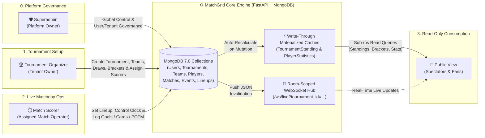

# MatchGrid — Master Project Plan & Architectural Blueprint

**Document Version:** 1.0.0  
**Target Path:** `docs/plan.md`  
**Project Name:** MatchGrid (Evolved from DCL Season 5 Digital Scoreboard)  
**Architecture:** Multi-Tenant, Multi-Tournament Live Football Management & Real-Time Scoreboard Platform  
**Implementation Blueprint:** [`docs/IMPLEMENTATION_ROADMAP.md`](IMPLEMENTATION_ROADMAP.md) (7-Phase Execution Matrix with 7-Stage Lifecycle)

---

## 1. Project Goal

The primary goal of **MatchGrid** is to transform a single-event, hardcoded 6-team internship application (*DCL Season 5 Digital Scoreboard*) into an **industry-standard, multi-tenant, multi-tournament live football SaaS platform**.

Specifically, this project aims to achieve four core objectives:
1. **Eliminate Single-Tournament & Hardcoded Constraints:** Replace rigid 6-team / 2-group / single-admin logic with a dynamic tournament engine capable of running multiple concurrent tournaments with customizable group sizes, round-robin fixtures, and knockout brackets.
2. **Enforce Strict 4-Tier Role-Based Access Control (RBAC):** Establish clear operational boundaries across **Superadmins** (platform owners), **Tournament Organizers** (tenant owners), **Match Scorers** (matchday operators), and **Public Spectators** (read-only viewers).
3. **Deliver Broadcast-Grade Real-Time Telemetry:** Provide sub-second live score updates, UTC-synchronized match clocks with drift-free half-time pause/resume, and pre-computed materialized standings/leaderboards powered by room-scoped WebSockets.
4. **Build a Flagship Placement & Engineering Portfolio Project:** Demonstrate production-grade full-stack engineering—covering clean monorepo organization, write-through caching, distributed locking, automated unit/integration/E2E testing, and zero-cost cloud deployment.

---

## 2. Overall Idea & Core Concept

### 2.1 Operational Pipeline & Four-Tier Role Hierarchy

MatchGrid operates as a structured operational pipeline where platform governance, tournament setup, live matchday scoring, and public consumption are cleanly decoupled:

```
1. Superadmin (Platform Owner — Us)
   └── Global control over the entire application, all tournaments, users, and system settings
        │
2. Tournament Organizer (Tenant Owner)
   └── Scoped strictly to tournaments they organize (teams, rosters, draws, brackets, scorer assignment)
        │
3. Match Scorer (Matchday Operator)
   └── Scoped strictly to specific matches assigned to them by an Organizer (clock, lineups, live events)
        │
4. Public View (Spectators & Fans)
   └── Unauthenticated, read-only access to the tournament hub, live scoreboards, standings & brackets
```

#### Role Permissions & Isolation Matrix

| Tier / Role | System Identity & Scope | Core Responsibilities | Database & API Enforcement |
| :--- | :--- | :--- | :--- |
| **1. Superadmin**<br>(`SUPER_ADMIN`) | **Platform Owner (Us)**<br>Global access across the entire application | • Full control over all tournaments, organizers, scorers, and platform settings<br>• Approve, suspend, or manage Organizer and Scorer accounts<br>• View, edit, intervene in, or delete any tournament, match, or record<br>• Monitor system health, database metrics, and global audit logs | • Bypasses `organizer_id` and `assigned_scorer_ids` ownership filters<br>• Exclusive access to `/api/superadmin/*` platform governance endpoints |
| **2. Tournament Organizer**<br>(`ORGANIZER`) | **Tenant Owner**<br>Scoped strictly to `tournament.organizer_id == user.id` | • Create and configure their own tournaments (groups, teams, rosters, point rules, knockout format)<br>• Run random group draws, generate fixtures, and seed knockout brackets<br>• Create/manage **Match Scorers** and assign them to specific matches<br>• Act as fallback live scorer for matches within their own tournaments | • Every query and mutation enforces `tournament.organizer_id == current_user.id`<br>• Completely isolated from tournaments belonging to other organizers |
| **3. Match Scorer**<br>(`SCORER`) | **Matchday Operator**<br>Scoped strictly to `user.id in match.assigned_scorer_ids` | • Access the **Live Match Console** exclusively for assigned matches<br>• Configure active match lineups<br>• Control the UTC-synced match clock (Start, Half-Time, Resume, Reset, End/Reopen)<br>• Log real-time events (Goals, Assists, Yellow/Red Cards, Player of the Match) | • Blocked from tournament settings, team/player CRUD, bracket generation, and unassigned matches<br>• Write access restricted to `/matches/:id/live`, `/lineup`, and `/events` for assigned matches |
| **4. Public View**<br>(`PUBLIC`) | **Unauthenticated**<br>Read-only access to public tournaments | • Browse the multi-tournament directory (Live, Upcoming, Completed)<br>• Watch real-time scoreboards and synced live match clocks<br>• View group standings, visual knockout brackets, team squads, and player leaderboards | • `GET`-only endpoints reading from pre-computed materialized caches + room-scoped `/ws/live` |

---

### 2.2 End-to-End System Workflow



---

### 2.3 Core Technical & Visual Pillars

1. **Dynamic Tournament & Bracket Engine:**
   * Supports configurable group counts ($N$ groups of $M$ teams), customizable point systems (Win/Draw/Loss), circle-method round-robin fixture generation, and dynamic knockout bracket seeding (4-team Semi-Finals, 8-team Quarter-Finals, or 16-team Round of 16) with manual penalty-shootout winner overrides.
2. **Write-Through Materialized Views:**
   * Public read traffic never runs expensive on-the-fly aggregations. Every match completion or event mutation updates pre-computed `TournamentStanding` and `PlayerStatistics` documents using batched MongoDB `$in` queries.
3. **Room-Scoped WebSocket Cache Invalidation:**
   * Instead of broadcasting events globally to all users, `/ws/live` scopes connections by `tournament_id`. Spectators watching Tournament A receive lightweight invalidation signals (`match_event_added`, `match_status_changed`) only for Tournament A.
4. **Drift-Free UTC Match Clock (`tz_aware=True`):**
   * All timestamps are stored in timezone-aware UTC. Elapsed match time is computed dynamically as $\max(0, \text{now}_{\text{UTC}} - \text{started\_at}_{\text{UTC}})$, with half-time pause freezing `elapsed_seconds` and resume backdating `started_at`.
5. **MatchGrid Brand Identity & Two-Tier UI:**
   * **Visual Theme:** Deep Stadium Slate (`#0B0F14` canvas, `#131A22` card surface, `#1C2530` elevated panels), Pitch Emerald (`#10B981`), Goalpost White (`#F8FAFC`), Broadcast Crimson (`#EF4444`), and Champion Gold (`#F59E0B`), paired with tabular numerals (`tabular-nums`) for zero-jitter live clocks.
   * **Navigation:** Two-tier responsive layout separating the **Global Tournament Discovery Header** from the **Tournament-Scoped Context Bar** (`/t/:slug/...`) and **Role-Based Dashboards** (`/superadmin`, `/organizer`, `/scorer`).

---

## 3. Entire Project Plan (Phased Roadmap)

> [!TIP]
> The stage-by-stage engineering blueprint (DB, Backend, Frontend and Playwright E2E per phase, with test counts) is [`IMPLEMENTATION_ROADMAP.md`](IMPLEMENTATION_ROADMAP.md). This section is the summary; the roadmap is the source of truth for phase numbering.

| Phase | Theme | Status |
| :--- | :--- | :--- |
| **0** | Foundation, Bun monorepo, MatchGrid rebrand, Playwright setup, clean data slate | Completed |
| **1** | Four-tier RBAC & multi-tenant isolation (`User` roles, `organizer_id`, `tournament_id` everywhere, `assigned_scorer_ids`) | Completed |
| **2** | Cloudflare R2 media pipeline (`/api/uploads/image`, tournament-scoped keys, cleanup on replace/delete) | Completed |
| **3** | Dynamic tournament engine (`TournamentConfig`, circle-method fixtures, group draw, quarters/semis/final seeding, penalty overrides) | Completed |
| **4** | Room-scoped WebSockets (`/ws/live?tournament_id=`) and the scorer live console | Completed |
| **5** | Public two-tier UI (`/` hub, `/t/:slug/*` tournament center, visual bracket tree) | Completed |
| **6** | Role portals (`/superadmin`, `/organizer`, `/scorer`, unified `/login`) | Completed |
| **Pre-7 audit** | Security, isolation, bracket-engine and legacy cleanup findings from [`Audit.md`](Audit.md) (waves 1-3) | Completed on `fix/pre-phase7-audit` |
| **7** | Production hardening, CI/CD and zero-cost cloud launch (Atlas + Render/DigitalOcean + Cloudflare R2) | Next up |

### Conventions that hold across phases
* **No default tournament.** Every public list endpoint takes `tournament_id` or `tournament_slug`, and every write names its tournament explicitly. Unowned (`organizer_id is None`) tournaments are superadmin-only.
* **Public URLs live under `/t/:slug/...`.** Old single-tournament URLs (`/matches/:id`, `/teams/:id`, `/players/:id`) redirect to their tournament; `/admin` redirects to `/organizer`.
* **Tournament lifecycle enums:** `status` is `draft | active | completed` and `stage` is `group | quarters | semis | final | champions` (a crowned champion completes the tournament).
* **The server owns the match clock.** Responses carry `server_now`; clients derive elapsed time from server fields, never from local storage or their own clock.

---

## 4. What to Do (Actionable Execution Guide)

### 4.1 Immediate Next Actions (Step-by-Step)

1. **Execute Phase 7 (hardening and launch):** follow [`IMPLEMENTATION_ROADMAP.md`](IMPLEMENTATION_ROADMAP.md) Phase 7 and the runbook in [`../DEPLOYMENT.md`](../DEPLOYMENT.md).
2. **Before scaling out:** the WebSocket hub and the login rate limiter are in-process (see the "Scaling constraints" section of the runbook); run a single backend instance until they move to shared state.
3. **Run the full regression gate** (`bun run test:all`) on every change, per the workflow below.

---

### 4.2 Mandatory 7-Stage Feature Development Workflow

Every new feature or refactor in **MatchGrid** must follow this 7-stage engineering pipeline:

| Stage | Activity & Quality Gate | Command / Verification |
| :--- | :--- | :--- |
| **1. Plan Feature** | Define scope, acceptance criteria, edge cases, and affected roles (`Superadmin`, `Organizer`, `Scorer`, `Public`). | Review feature spec before coding |
| **2. Architecture Design** | Design Beanie models/indexes, FastAPI endpoints, WebSocket events, and React components. | Approve implementation blueprint |
| **3. Implementation** | Build bottom-up in strict order: **DB** (models + migrations) $\rightarrow$ **Backend** (services + routers + Pytest) $\rightarrow$ **Frontend** (API + UI + Vitest). | `bun run test:backend` & `bun run test:frontend` |
| **4. Playwright Testing** | Write feature-specific E2E specs in `e2e/tests/` verifying browser flows, RBAC boundaries, and live WebSockets. | `bun run test:e2e` |
| **5. Push to Working Branch** | Commit changes cleanly to a dedicated branch (`feat/<slug>` or `fix/<slug>`) and push to remote. | `git checkout -b feat/<slug> && git push -u origin feat/<slug>` |
| **6. Full Regression Gate** | Execute the entire full-stack verification suite up to the current stage. | `bun run test:all` |
| **7. Merge to Main** | Merge verified working branch into `main` only after Stage 6 passes 100%. | `git checkout main && git merge --no-ff feat/<slug> && git push` |

---

## 5. What Will Be the Final Output

Upon completing all phases, **MatchGrid** will be a complete, production-deployed sports SaaS platform with the following concrete deliverables:

### 5.1 User-Facing Product Capabilities
* **For Superadmins (`/superadmin`):** A centralized command center with full visibility and control over the entire platform—managing all Organizers, Scorers, active/archived tournaments, system health, and administrative overrides.
* **For Tournament Organizers (`/organizer`):** A self-service tournament management workspace to launch concurrent tournaments, configure custom formats, manage teams and player rosters, run animated group draws, generate fixtures/brackets, and assign Scorers to individual matches.
* **For Match Scorers (`/scorer`):** A streamlined matchday cockpit showing only their assigned fixtures, featuring a mobile-friendly **Live Match Control Console** with a drift-free UTC match timer and one-tap event logging (goals, assists, cards, POTM).
* **For Public Spectators (`/` & `/t/:slug`):** A fast, broadcast-styled live sports hub displaying concurrent tournaments, real-time synced match clocks and scores via WebSockets, color-coded group standings, interactive knockout bracket trees, and player leaderboards.

### 5.2 Engineering & Portfolio Artifacts
* **Clean Bun Monorepo:** Organized across `apps/backend`, `apps/frontend`, `e2e`, `docs`, and `docker-compose.yml` (MongoDB 7.0) with single-command startup (`bun run dev`).
* **Automated Quality Assurance:** A comprehensive test suite (`bun run test:all`) combining **250+ backend Pytest tests**, **frontend Vitest component tests**, and **Playwright E2E multi-role browser tests**, automated via **GitHub Actions CI**.
* **Live Production Deployment:** Publicly accessible URLs hosted on **Vercel** (Frontend SPA), **Render / Koyeb** (FastAPI + WebSocket server), and **MongoDB Atlas** (Persistent database) ready for live demonstrations and technical interviews.