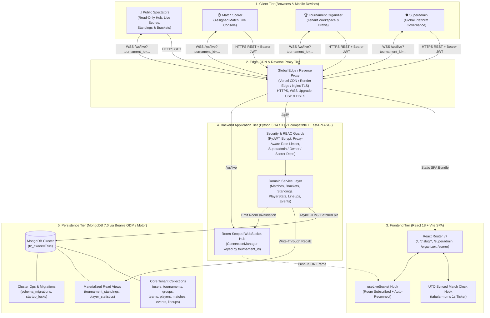
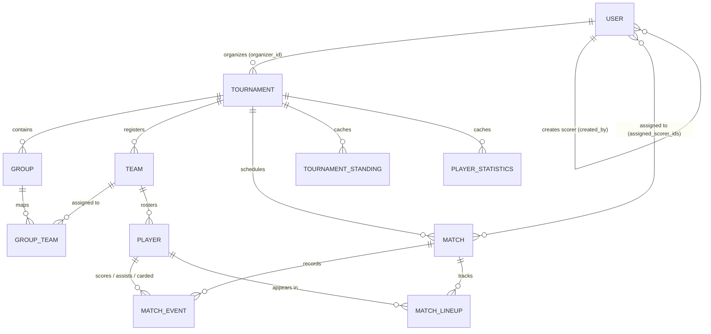
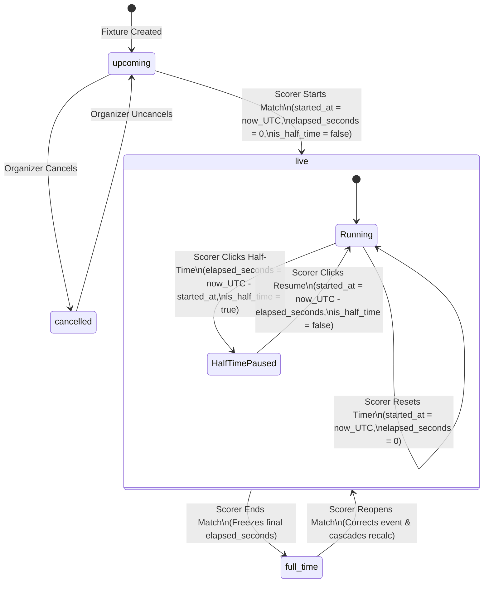
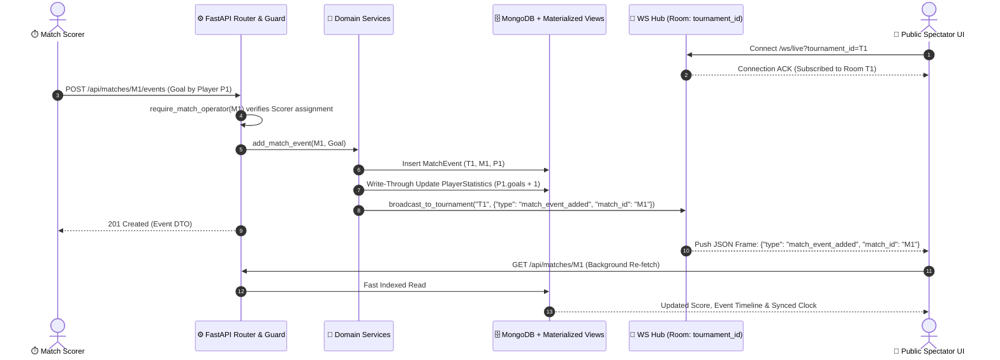
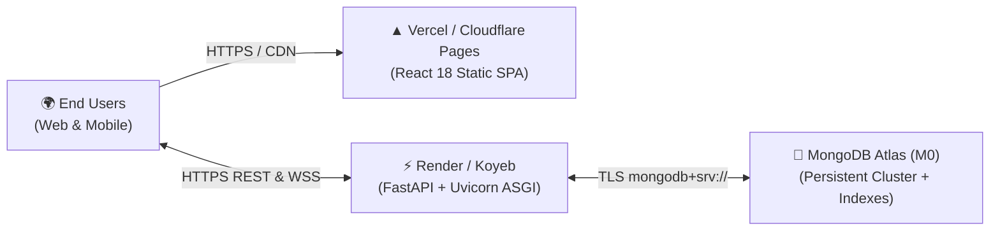

# MatchGrid — System & Software Architecture Design

**Document Version:** 1.0.0  
**Target Path:** `docs/system_architecture.md`  
**System Name:** MatchGrid (Multi-Tenant Live Football Tournament & Scoreboard Platform)  
**Architecture Style:** Layered Clean Architecture + Write-Through Materialized Views + Room-Scoped WebSockets  

---

## Table of Contents
1. [Architectural Overview & Design Principles](#1-architectural-overview--design-principles)
2. [High-Level System Architecture](#2-high-level-system-architecture)
3. [Monorepo & Application Layer Topology](#3-monorepo--application-layer-topology)
4. [Four-Tier RBAC & Security Architecture](#4-four-tier-rbac--security-architecture)
5. [Data Architecture & MongoDB Schema Design](#5-data-architecture--mongodb-schema-design)
6. [Core Domain Engines & Mathematical Models](#6-core-domain-engines--mathematical-models)
7. [Real-Time Telemetry & WebSocket Architecture](#7-real-time-telemetry--websocket-architecture)
8. [Frontend Architecture & Two-Tier UI Topology](#8-frontend-architecture--two-tier-ui-topology)
9. [Testing, CI/CD & Production Deployment Architecture](#9-testing-cicd--production-deployment-architecture)

---

## 1. Architectural Overview & Design Principles

**MatchGrid** is a multi-tenant, multi-tournament sports SaaS platform designed to orchestrate concurrent football tournaments—from pre-tournament configuration and random group draws to live matchday scoring, real-time spectator scoreboards, and automated knockout bracket progression.

The system is engineered around six foundational architectural principles:

1. **Strict Multi-Tenant & Role-Based Isolation:** Data and operations are partitioned across a four-tier hierarchy (**Superadmin** $\rightarrow$ **Tournament Organizer** $\rightarrow$ **Match Scorer** $\rightarrow$ **Public Spectator**), enforced at both the FastAPI dependency layer and MongoDB compound-indexed queries.
2. **Write-Through Materialized Views:** Public spectator traffic is overwhelmingly read-heavy. Instead of running expensive on-the-fly `$lookup` or `$group` aggregations on every page load, group standings (`TournamentStanding`) and player leaderboards (`PlayerStatistics`) are pre-computed during match mutations and served in sub-millisecond reads.
3. **Lightweight Cache-Invalidation WebSockets:** Rather than streaming large state payloads over WebSockets (which risks client state desynchronization), `/ws/live` emits lightweight, room-scoped JSON invalidation signals (`match_event_added`, `match_status_changed`) that trigger targeted, non-blocking background re-fetches.
4. **Drift-Free UTC Timekeeping (`tz_aware=True`):** All timestamps across MongoDB, Python, and React are strictly timezone-aware UTC. Match clocks are computed mathematically from server UTC anchors rather than relying on fragile server-side background timer threads.
5. **Batched Query Execution ($O(1)$ Round-Trips):** Match lists and standings recalculations fetch related goal/card events using single batched MongoDB `$in` queries, eliminating $N+1$ database round-trips.
6. **Fail-Fast Defense-in-Depth:** Startup assertions block insecure production deployments, atomic MongoDB locks prevent multi-worker migration races, and proxy-aware exponential backoff protects authentication endpoints without risking live-match account lockouts.

---

## 2. High-Level System Architecture



---

## 3. Monorepo & Application Layer Topology

MatchGrid is organized as a **Bun workspace monorepo** where MongoDB 7.0 runs in a lightweight Docker container while the FastAPI backend and React/Vite frontend run natively on the host for zero-latency hot reloading.

```text
MatchGrid/
├── apps/
│   ├── backend/                     # Python 3.14 + FastAPI ASGI Backend
│   │   ├── app/
│   │   │   ├── core/                # Config, DB, JWT/Bcrypt, RBAC Deps, Rate Limiter, WS Hub
│   │   │   ├── migrations/          # Sequential forward schema migrations (m0001..m0005+)
│   │   │   ├── models/              # Beanie ODM Document schemas & compound indexes
│   │   │   ├── routers/             # REST & WebSocket controllers (/api/*, /ws/live, /health)
│   │   │   ├── schemas/             # Pydantic v2 request/response DTOs
│   │   │   ├── scripts/             # CLI maintenance & superadmin bootstrap utilities
│   │   │   ├── services/            # Pure domain business logic & cache recalculators
│   │   │   └── main.py              # FastAPI app factory, CORS, error handlers & lifespan
│   │   ├── tests/                   # Pytest async integration & unit test suite
│   │   └── requirements-dev.txt     # Pinned Python dependencies
│   │
│   └── frontend/                    # React 18 + Vite 6 Single Page Application
│       ├── public/assets/brand/     # MatchGrid SVG/PNG logo & favicon assets
│       ├── src/
│       │   ├── api/                 # Typed HTTP client & domain API modules
│       │   ├── components/          # Modular UI (layout, common, match, bracket, stats, portals)
│       │   ├── context/             # AuthContext & WebSocketContext providers
│       │   ├── hooks/               # useLiveSocket, useMatchClock, useTournamentScope
│       │   ├── pages/               # Public Hub, Tournament Views, Superadmin/Organizer/Scorer Portals
│       │   ├── routes/              # Role-guarded React Router definitions
│       │   └── index.css            # MatchGrid CSS custom properties & design tokens
│       └── package.json             # Frontend scripts & Vitest config
│
├── e2e/                             # Playwright End-to-End Test Suite
│   ├── fixtures/                    # Multi-role API auth helpers & automatic DB teardown
│   └── tests/                       # Public smoke, RBAC isolation, and live WebSocket E2E specs
│
├── docs/                            # Architectural & operational documentation
│   ├── plan.md                      # Master project roadmap & 7-stage lifecycle
│   ├── system_architecture.md       # Complete system & architecture blueprint (this file)
│   └── DEVELOPMENT_WORKFLOW.md      # 7-stage engineering pipeline guide
│
├── .github/workflows/ci.yml         # Automated CI/CD verification pipeline
├── docker-compose.yml               # Isolated MongoDB 7.0 container with healthcheck
├── playwright.config.ts             # Root Playwright configuration
└── package.json                     # Root Bun workspace & unified orchestration scripts
```

### Backend Layered Dependency Rule
Dependencies strictly flow inward from transport to persistence—routers never execute raw database queries, and services never depend on HTTP request objects:

```text
[FastAPI Routers] ──▶ [RBAC & Auth Dependencies] ──▶ [Domain Services] ──▶ [Beanie Models / MongoDB]
       │                                                    │
       ▼                                                    ▼
[Pydantic DTOs]                                    [WebSocket Hub Broadcast]
```

---

## 4. Four-Tier RBAC & Security Architecture

### 4.1 Role Hierarchy & Scoping Rules

MatchGrid enforces a strict four-tier access control model separating global platform governance from tenant administration, live match operations, and public consumption:

```text
Tier 1: SUPER_ADMIN (Platform Owner — Us)
   └── Global unrestricted access across all tournaments, users, matches & system settings
        │
Tier 2: ORGANIZER (Tenant Owner)
   └── Strictly scoped to tournaments where tournament.organizer_id == current_user.id
        │
Tier 3: SCORER (Matchday Operator)
   └── Strictly scoped to matches where current_user.id in match.assigned_scorer_ids
        │
Tier 4: PUBLIC (Spectators & Fans)
   └── Unauthenticated read-only access to public tournaments & live scoreboards
```

| Capability / Resource | `SUPER_ADMIN` | `ORGANIZER` | `SCORER` | `PUBLIC` |
| :--- | :---: | :---: | :---: | :---: |
| Manage Organizers & Platform Users (`/api/superadmin/*`) | **Full** | Blocked (`403`) | Blocked (`403`) | Blocked (`401`) |
| View / Intervene in Any Tournament Globally | **Full** | Own Only | Assigned Matches Only | Public Read-Only |
| Create & Configure Tournaments, Groups, Teams & Rosters | **Full** | Own Tournaments | Blocked (`403`) | Blocked (`401`) |
| Run Group Draws, Generate Fixtures & Seed Brackets | **Full** | Own Tournaments | Blocked (`403`) | Blocked (`401`) |
| Create Scorer Accounts & Assign Scorers to Matches | **Full** | Own Tournaments | Blocked (`403`) | Blocked (`401`) |
| Control Live Match Clock (Start, HT, Resume, End, Reopen) | **Full** | Own Tournaments | **Assigned Matches** | Blocked (`401`) |
| Set Match Lineups & Log Events (Goals, Cards, POTM) | **Full** | Own Tournaments | **Assigned Matches** | Blocked (`401`) |
| Read Live Scores, Standings, Brackets & Leaderboards | **Full** | **Full** | **Full** | **Full (`GET`)** |

### 4.2 FastAPI Authorization Guards (`app/core/deps.py`)

Authorization is enforced declaratively via composable FastAPI dependencies:

1. **`get_current_user`**: Extracts the `Authorization: Bearer <jwt>` header, validates the HMAC-SHA256 signature and expiration (`JWT_SECRET`), loads the active `User` document, and verifies `user.is_active == True`.
2. **`require_superadmin`**: Asserts `current_user.role == UserRole.SUPER_ADMIN`. Raises `403 Forbidden` otherwise.
3. **`require_tournament_owner(tournament_id)`**:
   * If `current_user.role == UserRole.SUPER_ADMIN`: Grants immediate access.
   * If `current_user.role == UserRole.ORGANIZER`: Fetches `Tournament` and asserts `tournament.organizer_id == current_user.id`.
   * Otherwise: Raises `403 Forbidden`.
4. **`require_match_operator(match_id)`**:
   * Fetches `Match` and parent `Tournament`.
   * Grants access if `current_user.role == UserRole.SUPER_ADMIN`, **or** (`current_user.role == UserRole.ORGANIZER` and `tournament.organizer_id == current_user.id`), **or** (`current_user.role == UserRole.SCORER` and `current_user.id in match.assigned_scorer_ids`).
   * Otherwise: Raises `403 Forbidden`.

### 4.3 Authentication, Rate Limiting & Production Hardening

* **Password & Token Security:** Passwords are salted and hashed with `bcrypt`. Stateless JWTs embed `sub` (user ObjectId), `role`, and `exp` (default 12 hours).
* **Proxy-Aware Exponential Backoff Rate Limiter (`app/core/rate_limit.py`):**
  * Extracts client IP from `X-Forwarded-For` using `TRUSTED_PROXY_HOPS` (taking the $N$-th entry from the right appended by trusted edge proxies so spoofed leftmost headers are ignored).
  * Allows $5$ free login attempts per IP to tolerate operator typos. For attempt $k > 5$, enforces an exponential cooldown delay:
    $$\text{Delay}(k) = \min\left(60,\; 2^{k - 6}\right) \text{ seconds}$$
  * **Zero Account Lockout Policy:** Accounts are never locked out globally, preventing an attacker from triggering a Denial-of-Service against a live match scorer during a tournament.
* **Fail-Fast Production Safety (`app/core/production_safety.py`):** When `ENVIRONMENT=production`, startup aborts immediately if `JWT_SECRET` is shorter than $32$ characters, default bootstrap passwords are unchanged, or `CORS_ORIGINS` contains wildcard/localhost entries.
* **Atomic Distributed Startup Locks (`app/core/bootstrap.py`):** Uses a unique-indexed `startup_locks` collection with TTL expiration so concurrent container replicas never race during schema migrations or Superadmin bootstrapping.

---

## 5. Data Architecture & MongoDB Schema Design

### 5.1 Entity-Relationship Diagram



### 5.2 Collection & Index Specifications

All tenant-scoped child collections carry an indexed `tournament_id` field to ensure complete multi-tournament isolation and sub-millisecond query execution.

| Collection | Model Class | Key Fields | Critical Indexes |
| :--- | :--- | :--- | :--- |
| `users` | `User` | `username`, `email`, `password_hash`, `role` (`SUPER_ADMIN` \| `ORGANIZER` \| `SCORER`), `organization_name`, `created_by`, `is_active` | `username` (unique), `email` (unique sparse), `role` |
| `tournaments` | `Tournament` | `organizer_id`, `name`, `slug`, `season`, `status` (`draft` \| `active` \| `completed`), `stage`, `champion_team_id`, `config` (`TournamentConfig`) | `slug` (unique), `(organizer_id, status)` |
| `groups` | `Group` | `tournament_id`, `name` (e.g., `Group A`, `Group B`), `display_order` | `(tournament_id, name)` (unique) |
| `group_teams` | `GroupTeam` | `tournament_id`, `group_id`, `team_id` | `(tournament_id, team_id)` (unique), `(tournament_id, group_id)` |
| `teams` | `Team` | `tournament_id`, `name`, `short_name`, `color` (hex), `crest_url` | `(tournament_id, name)` (unique) |
| `players` | `Player` | `tournament_id`, `team_id`, `name`, `number`, `player_code` (optional), `is_manager`, `photo_url` | `(tournament_id, team_id, number)` (unique), `(tournament_id, player_code)` (sparse unique) |
| `matches` | `Match` | `tournament_id`, `match_number`, `stage` (`group` \| `quarter_final` \| `semi_final` \| `final` \| `friendly`), `group_id`, `bracket_slot`, `team1_id` *(home)*, `team2_id` *(away)*, `assigned_scorer_ids`, `status`, `started_at`, `elapsed_seconds`, `is_half_time`, `winner_override_id` | `(tournament_id, status, scheduled_at)`, `(tournament_id, stage)`, `assigned_scorer_ids`, `(tournament_id, match_number)` (unique) |
| `match_events` | `MatchEvent` | `tournament_id`, `match_id`, `team_id`, `player_id`, `assist_player_id`, `type` (`goal` \| `yellow` \| `red` \| `potm`), `minute` | `(tournament_id, match_id, minute)`, `(tournament_id, player_id)` |
| `match_lineups` | `MatchLineup` | `tournament_id`, `match_id`, `team_id`, `player_ids` | `(tournament_id, match_id, team_id)` (unique) |
| `tournament_standings` | `TournamentStanding` | `tournament_id`, `group_id`, `team_id`, `played`, `won`, `drawn`, `lost`, `goals_for`, `goals_against`, `goal_difference`, `points` | `(tournament_id, group_id, points, goal_difference, goals_for)` |
| `player_statistics` | `PlayerStatistics` | `tournament_id`, `player_id`, `team_id`, `appearances`, `goals`, `assists`, `yellow_cards`, `red_cards`, `potm_awards` | `(tournament_id, goals)`, `(tournament_id, assists)`, `(tournament_id, potm_awards)` |
| `schema_migrations` | `SchemaMigration` | `migration_id`, `applied_at` | `migration_id` (unique) |
| `startup_locks` | `StartupLock` | `lock_name`, `owner_id`, `expires_at` | `lock_name` (unique), `expires_at` (TTL) |

#### Embedded `TournamentConfig` Sub-Document (`Tournament.config`)
```json
{
  "num_groups": 2,
  "teams_per_group": 4,
  "qualifiers_per_group": 2,
  "knockout_format": "semis_final",
  "points_win": 3,
  "points_draw": 1,
  "points_loss": 0,
  "half_duration_minutes": 45
}
```

### 5.3 Query Batching & $N+1$ Prevention
When rendering lists of $N$ matches or recalculating standings across an entire group, MatchGrid avoids issuing $2N$ individual count queries. Instead, `compute_scores_and_winners()` executes a single batched MongoDB `$in` query:
```python
goal_events = await MatchEvent.find(
    In(MatchEvent.match_id, match_ids),
    MatchEvent.type == EventType.GOAL,
).to_list()
```
Scores and match winners are aggregated in an $O(E)$ in-memory pass over the returned events, reducing database network round-trips from $O(N)$ to $O(1)$.

---

## 6. Core Domain Engines & Mathematical Models

### 6.1 Drift-Free UTC Match Clock Engine

MatchGrid does not run background `asyncio.sleep` loops on the server to increment match clocks (which drift under CPU load and break across server restarts). Instead, clock state is stored deterministically on the `Match` document using timezone-aware UTC datetimes (`tz_aware=True`):



At any instant $t_{\text{now}}$ (both on the backend API serializer and on the client's 1-second UI ticker), the exact elapsed match time $E(t_{\text{now}})$ in seconds is computed as:

$$
E(t_{\text{now}}) = \begin{cases} 
0, & \text{if } \text{status} \in \{\text{upcoming}, \text{cancelled}\} \\[6pt]
\text{elapsed\_seconds}, & \text{if } \text{is\_half\_time} = \text{true} \;\lor\; \text{status} = \text{full\_time} \\[6pt]
\max\!\left(0,\; \lfloor t_{\text{now}} - \text{started\_at} \rfloor\right), & \text{if } \text{status} = \text{live} \;\land\; \text{is\_half\_time} = \text{false}
\end{cases}
$$

When a match is paused at half-time at $t_{\text{pause}}$, the server snapshots $E_{\text{HT}} = \max(0, \lfloor t_{\text{pause}} - \text{started\_at} \rfloor)$. When resumed at $t_{\text{resume}}$, the server backdates $\text{started\_at} \leftarrow t_{\text{resume}} - E_{\text{HT}}$ so the running formula resumes seamlessly without a single second of drift.

---

### 6.2 Dynamic Tournament, Fixture & Knockout Bracket Engine

#### A. Circle-Method Round-Robin Fixture Generator
Given a group $G$ containing $M$ teams $[T_0, T_1, \dots, T_{M-1}]$ (if $M$ is odd, a `BYE` sentinel is appended so $M'$ is even), the scheduler fixes $T_0$ and rotates $[T_1, \dots, T_{M'-1}]$ across $M' - 1$ matchdays, generating $\frac{M(M-1)}{2}$ unique fixtures per group with balanced home/away assignments.

#### B. Deterministic Standings Tiebreaker Comparator
Within each group, `TournamentStanding` rows are ranked using a strict multi-key tuple comparator:
$$\text{RankKey}(T) = \big(\text{Points},\; \text{GoalDifference},\; \text{GoalsFor},\; -\text{LexicographicalOrder}(\text{TeamName})\big)$$
where $\text{Points} = (W \times P_{\text{win}}) + (D \times P_{\text{draw}}) + (L \times P_{\text{loss}})$ and $\text{GoalDifference} = \text{GF} - \text{GA}$.

#### C. Dynamic Knockout Seeding & Penalty Shootout Tiebreaks
Once all `group` stage matches reach `full_time`, the bracket engine reads `tournament.config.knockout_format` and seeds cross-group knockout pairings so top finishers from the same group cannot meet until the Final:
* **`semis_final` (4 Teams):** $\text{SF1} = (A_1 \text{ vs } B_2)$, $\text{SF2} = (B_1 \text{ vs } A_2)$ $\rightarrow$ $\text{Final} = (\text{Winner SF1} \text{ vs } \text{Winner SF2})$.
* **`quarters_semis_final` (8 Teams):** Cross-seeds top 2 from 4 groups ($A_1 \text{ vs } B_2$, $C_1 \text{ vs } D_2$, $B_1 \text{ vs } A_2$, $D_1 \text{ vs } C_2$) $\rightarrow$ Semi-Finals $\rightarrow$ Final.
* **Knockout Winner Resolution:** If a knockout match ends level in regular/extra time ($\text{Score}_{\text{home}} = \text{Score}_{\text{away}}$), the Scorer or Organizer records the penalty shootout winner via `winner_override_team_id`, unlocking downstream bracket progression.

---

### 6.3 Write-Through Materialized View Engine

Every state-mutating operation cascades through a deterministic recalculation pipeline before returning an HTTP response:

```text
[Mutation: Add/Delete Event, Set Lineup, End/Reopen/Delete Match]
       │
       ├──▶ 1. Persist primary document change (MatchEvent / MatchLineup / Match)
       │
       ├──▶ 2. Recompute affected PlayerStatistics (goals, assists, cards, POTM, appearances)
       │       (Note: Friendly/extra matches are excluded from official tournament stats)
       │
       ├──▶ 3. If match.stage == "group":
       │       Recompute TournamentStanding for all teams in match.group_id
       │
       └──▶ 4. Emit room-scoped WebSocket invalidation frame to tournament_id subscribers
```

---

## 7. Real-Time Telemetry & WebSocket Architecture

### 7.1 Room-Scoped `ConnectionManager` (`app/core/websocket.py`)

To support dozens of concurrent tournaments without cross-tenant noise, WebSocket connections are partitioned into rooms indexed by `tournament_id`:

```python
class ConnectionManager:
    def __init__(self) -> None:
        # Maps tournament_id -> set of active WebSocket connections
        # "global" room receives platform-wide broadcast alerts
        self.rooms: dict[str, set[WebSocket]] = defaultdict(set)
```

Clients connect via `wss://<host>/ws/live?tournament_id=<tournament_id>` (or send a `{"action": "subscribe", "tournament_id": "..."}` handshake). If no `tournament_id` is supplied, connections default to the `"global"` room. When any mutation occurs inside Tournament $X$, `broadcast_to_tournament(tournament_id, payload)` pushes the frame **exclusively** to sockets subscribed to Tournament $X$ and optionally echoes to `"global"` if configured.

### 7.2 End-to-End Live Scoring Sequence



### 7.3 WebSocket Event Payload Catalog

| Event `type` | Trigger Action | Frontend Subscriber Reaction |
| :--- | :--- | :--- |
| `match_status_changed` | Match started, half-time paused, resumed, ended, reopened, or cancelled | Re-fetches match details, syncs `started_at`/`elapsed_seconds`, refreshes standings & bracket |
| `match_event_added` | Goal, Yellow Card, Red Card, or POTM logged | Re-fetches live scoreboard, match event timeline, and player leaderboards |
| `match_event_deleted` | Mis-recorded event removed by Scorer/Organizer | Re-fetches live scoreboard, rolls back timeline & player leaderboards |
| `lineup_updated` | Match lineup saved | Re-fetches match lineups and player appearance counts |
| `standings_updated` | Group draw, fixture generation, or knockout seeding executed | Re-fetches group standings tables and visual knockout bracket tree |

---

## 8. Frontend Architecture & Two-Tier UI Topology

### 8.1 Route & Navigation Architecture

The React 18 SPA uses a **two-tier navigation shell** separating cross-tournament discovery from tournament-scoped views and role-specific operational portals:

```text
├── Public Discovery Tier (Global Top Header)
│   ├── /                          → Public Tournament Hub (Live, Upcoming & Completed Directory)
│   └── /login                     → Unified Role Login (Routes to /superadmin, /organizer, or /scorer)
│
├── Tournament-Scoped Tier (Two-Tier Header + Mobile Slide-Over Drawer)
│   └── /t/:slug                   → Tournament Context Layout (Subscribes useLiveSocket to tournament_id)
│       ├── /t/:slug               → Match Center Overview (Featured Live Match & Stage Banner)
│       ├── /t/:slug/matches       → Filterable Fixtures & Live/Completed Results
│       ├── /t/:slug/matches/:id   → Live Match Detail (Synced Clock, Event Timeline & Lineups)
│       ├── /t/:slug/standings     → Group Standings Tables & Interactive Knockout Bracket Tree
│       ├── /t/:slug/teams         → Participating Squads & Roster Cards
│       └── /t/:slug/stats         → Leaderboards (Top Scorers, Assists, Discipline, POTM)
│
└── Authenticated Role Portals (Protected by RoleGuard)
    ├── /superadmin                → Superadmin Command Center (All Organizers, Scorers, Tournaments & Overrides)
    ├── /organizer                 → Organizer Workspace (Tournament Wizard, Teams, Group Draw, Bracket & Scorer Assignment)
    └── /scorer                    → Scorer Matchday Cockpit (Assigned Matches List)
        └── /scorer/matches/:id    → Split-Pane Live Match Control Console (Clock Pad + Quick Event Logger)
```

### 8.2 Visual Design System & Accessibility

Styled with modular CSS custom properties (`apps/frontend/src/index.css`) derived from the **MatchGrid** brand identity:
* **Surface Hierarchy:** Deep Stadium Slate (`#0B0F14` canvas, `#131A22` surface cards, `#1C2530` elevated panels) with crisp `1px` grid dividers (`#24303E`).
* **Brand & Semantic Accents:** Pitch Emerald (`#10B981`) for primary actions and knockout qualification zones; Broadcast Crimson (`#EF4444`) for pulsing `LIVE` indicators and red cards; Referee Amber (`#FACC15`) for yellow cards; Champion Gold (`#F59E0B`) for tournament winners and POTM crowns.
* **Zero-Jitter Telemetry:** All live match clocks, score digits, and standings columns enforce `font-variant-numeric: tabular-nums` with a contrast ratio exceeding **16:1 (WCAG AAA)**.
* **Team Color Containment:** Organizer-defined team colors (`team.color`) render strictly as `4px` vertical accent bars or avatar rings so bright custom colors never compromise text legibility.

---

## 9. Testing, CI/CD & Production Deployment Architecture

### 9.1 Multi-Layer Automated Verification Gate (`bun run test:all`)

Every feature branch must pass four sequential quality gates before merging into `main`:

1. **Backend Integration & Unit Suite (`bun run test:backend`):** Runs `pytest` against an isolated `matchgrid_test` database, verifying RBAC isolation (`403` cross-tenant & unassigned-scorer checks), UTC timer math, dynamic bracket generation, `$in` batch query counts, and room-scoped WebSockets.
2. **Frontend Component Suite (`bun run test:frontend`):** Runs `vitest` with React Testing Library to verify role-guarded routes, live match control state transitions, and responsive layouts.
3. **Production Bundle Check (`bun run build`):** Compiles the Vite production asset bundle to catch dead imports or syntax regressions.
4. **End-to-End Browser Verification (`bun run test:e2e`):** Runs **Playwright** across isolated browser contexts to test the complete multi-role lifecycle (`Superadmin -> Organizer -> Scorer -> Real-Time Public Spectator`) with automatic API teardown cleanup.

### 9.2 Zero-Cost Split-Cloud Production Topology



### 9.3 Horizontal Scaling Roadmap (Future Multi-Replica Extension)

The current backend maintains WebSocket rooms (`ConnectionManager`) and IP rate-limit counters (`LoginRateLimiter`) in single-process memory, which easily handles hundreds of concurrent spectators per tournament on a single ASGI worker. When scaling horizontally across multiple stateless FastAPI replicas behind a load balancer:
1. **Redis Pub/Sub Backplane:** Publish room invalidation frames (`tournament:<id>:events`) to Redis Pub/Sub so every FastAPI worker forwards messages to its locally connected WebSocket clients.
2. **Distributed Rate-Limit Counters:** Store sliding-window IP failure counts in Redis (`INCR` + `EXPIRE`) so exponential backoff state is shared across all replicas.